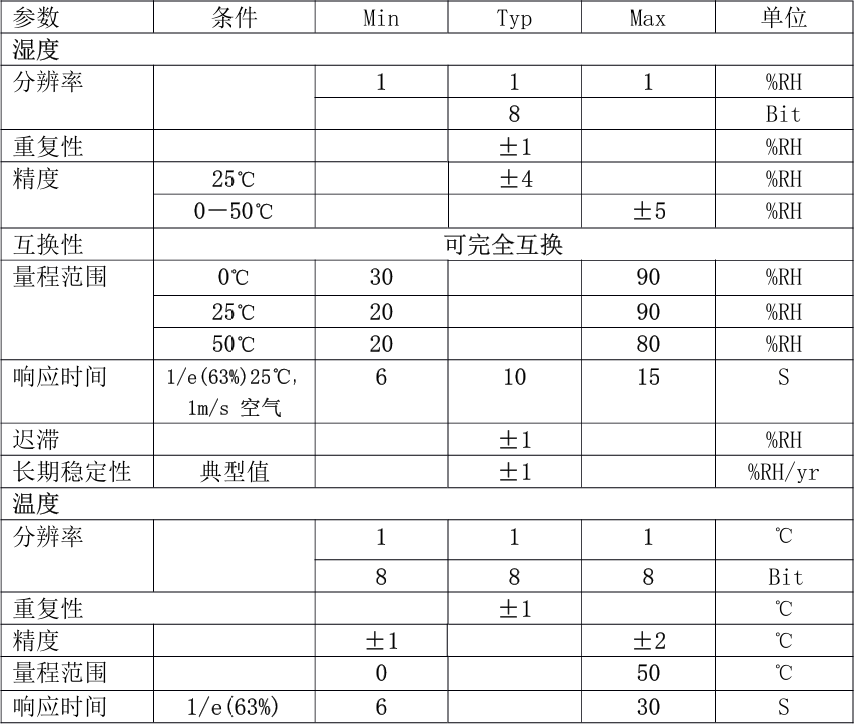
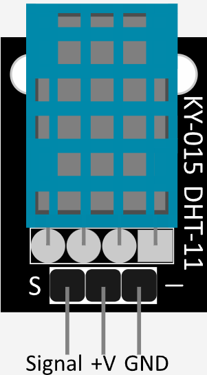
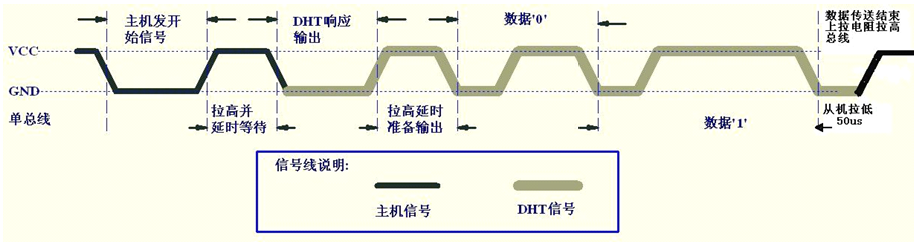
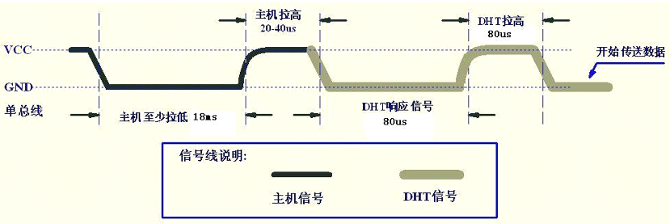
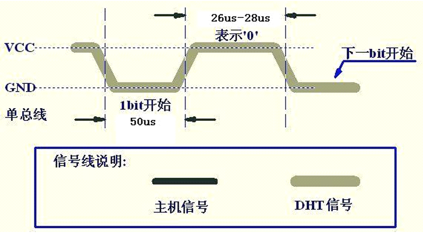
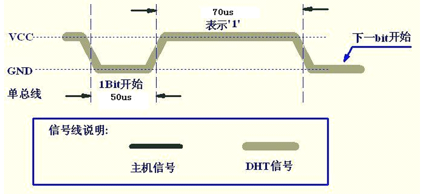

# `KY-015`

> 参考文档：
>
> 《数字温湿度传感器DHT11》


## 1、设备简介

### 1.1 设备概述

​	`KY-015`有另外一个名称`DHT11`，是一款含有已校准数字信号输出的温湿度复合传感器。传感器包含一个电阻式感湿元件和一个`NTC`测温元件，并与一个高性能8位单片机相连。

### 1.2 设备性能



​	可以看出，在不同温度条件下，传感器的湿度测量精度和量程有一定的差别。

### 1.3 接口说明



​	建议连接线长度短于20米时用`5KΩ`上拉电阻，大于20米时根据实际情况使用合适的上拉电阻。

​	供电电压为`3.3-5.5V`，传感器上电后，要等待`1s`以越过不稳定状态，在此期间无需发送任何指令。电源引脚之间可增加一个`100nF`的电容，用以去耦滤波。

### 1.4 串行接口

​	数据用于微处理器与`DHT11`之间的通讯和同步，采用单总线数据格式，一次通讯时间`4ms`左右，数据分为整数部分和小数部分，具体格式如下：

​	`8bit`湿度整数数据 + `8bit`湿度小数数据 + `8bit`温度整数数据 + `8bit`温度小数数据 + `8bit`校验和数据

​	一次完整的数据传输为`40bit`，高位先出。校验和数据为前四组数据相加之后所得结果的末8位。


​	用户`MCU`发送一次开始信号后，`DHT11`从低功耗模式转换到高速模式，等待主机开始信号结束后，`DHT11`发送响应信号，送出`40bit`的数据，并触发一次信号采集，用户可选择读取部分数据。从模式下，`DHT11`接收到开始信号触发一次温湿度采集，如果没有接收到主机发送开始信号，`DHT11`不会主动进行温湿度采集。采集数据后转换到低速模式。

​	通讯过程如下图所示：



​	总线空闲状态为高电平，主机把总线拉低等待`DHT11`响应，主机把总线拉低必须大于`18ms`，保证`DHT11`能检测到起始信号。`DHT11`接收到主机的开始信号后，等待主机开始信号结束，然后发送`80us`低电平响应信号。主机发送开始信号结束后，延时等待`20-40us`后，读取`DHT11`的响应信号，主机发送开始信号后，可以输出高电平，或者切换到输入模式，总线由上拉电阻拉高。



​	总线为低电平，说明`DHT11`发送响应信号，`DHT11`发送响应信号后，会再把总线拉高`80us`，然后开始发送数据。每一位数据都是以`50us`低电平时隙开始，高电平的长短定了数据位是0还是1。当数据传输完毕后，`DHT11`拉低总线`50us`，随后总线由上拉电阻拉高进入空闲状态。

​	数据为0信号图如下：



​	数据1信号图如下：



## 2、`KY-015`驱动

### 2.1 初始化和卸载

```
static int __init miscky_init(void)
{
        return platform_driver_register(&ky_driver);
}

static void __exit miscky_exit(void)
{
        platform_driver_unregister(&ky_driver);
}

module_init(miscky_init);
module_exit(miscky_exit);
MODULE_LICENSE("GPL");
MODULE_AUTHOR("ALIENTEK");
MODULE_INFO(intree, "Y");
```

### 2.2 设备和驱动匹配

```
static const struct of_device_id ky_of_match[] = {
     { .compatible = "alientek,ky" },
     { /* Sentinel */ }
 };


static struct platform_driver ky_driver = {
     .driver     = {
         .name   = "stm32mp1-ky",
         .of_match_table = ky_of_match,
     },
     .probe      = miscky_probe,
     .remove     = miscky_remove,
};
```

> ​	设备树描述如下：
>
> ```
> ky {
> 	compatible = "alientek,ky";
> 	ky-gpios = <&gpiog 3 GPIO_ACTIVE_HIGH>;
> 	status = "okay";
> };
> ```
>
> ​	笔者选用的是`PG3`这个`GPIO`管脚与`KY-015`设备的`DATA`管脚相连，然后通过控制`PG3`管脚电平来读取数据。设置`PG3`为高电平有效，则`GPIO`值为0表示低电平，为1表示高电平。
>
> ​	需要注意的是，`PG3`管脚还是`KEY_0`按键使用的管脚。由于驱动程序读取数据时存在一些类似如下的循环代码，可能会陷入死循环。这时可以通过按下`KEY_0`按键来跳出死循环。
>
> ```
> while(gpio_get_value(gpio) == 1)
> 	udelay(5);
> ```

### 2.3 注册和注销

```c
static int ky_gpio_init(struct device_node *nd)
{
        int ret;

        /* 从设备树中获取GPIO */
        miscky.ky_gpio = of_get_named_gpio(nd, "ky-gpios", 0);
        if(!gpio_is_valid(miscky.ky_gpio)) {
                printk("miscky：Failed to get ky-gpio\n");
                return -EINVAL;
        }

        /* 申请使用GPIO */
        ret = gpio_request(miscky.ky_gpio, "ky");
        if(ret) {
                printk("ky: Failed to request ky-gpio\n");
                return ret;
        }

		gpio_direction_output(miscky.ky_gpio, 1);
        return 0;
}

static struct file_operations miscky_fops = {
        .owner = THIS_MODULE,
        .open = miscky_open,
        .read = miscky_read,
};

static struct miscdevice ky_miscdev = {
        .minor = MISC_DYNAMIC_MINOR,
        .name = MISCKY_NAME,
        .fops = &miscky_fops,
};

static int miscky_probe(struct platform_device *pdev)
{
        int ret = 0;
    
        ret = ky_gpio_init(pdev->dev.of_node);
        if(ret < 0)
                return ret;

        ret = misc_register(&ky_miscdev);
        if(ret < 0){
                printk("misc device register failed!\r\n");
                goto free_gpio;
        }
        return 0;

free_gpio:
        gpio_free(miscky.ky_gpio);
        return -EINVAL;
}

static int miscky_remove(struct platform_device *dev)
{
        gpio_free(miscky.ky_gpio);
        misc_deregister(&ky_miscdev);
        return 0;
}
```

​	第19行，在申请到`GPIO`后设置其为输出模式并输出高电平，使其处于空闲模式。

### 2.4 读数据

```c
static ssize_t miscky_read(struct file *filp, char __user *buf, size_t cnt, loff_t *offt)
{
    int i;
    int ret = 0;
    u8 k_buf[5]={0};

    gpio_set_value(miscky.ky_gpio, 0);
    mdelay(25);
    gpio_set_value(miscky.ky_gpio, 1);
    udelay(20);
    gpio_direction_input(miscky.ky_gpio);
    while(gpio_get_value(miscky.ky_gpio) == 1)
		udelay(10);
    while(gpio_get_value(miscky.ky_gpio) == 0)
        udelay(10);
    while(gpio_get_value(miscky.ky_gpio) == 1)
        udelay(10);
    for (i = 0; i < 5; i++)
    	k_buf[i] = miscky_read_data();

    gpio_direction_output(miscky.ky_gpio, 1);

    copy_to_user(buf, k_buf, 5);

    return 0;
}

```

​	第7-8行，主机拉低`25ms`，即主机发送开始信号。

​	第9-10行，主机拉高`20us`，即主机发送开始信号结束。

​	第11行，设置`GPIO`为输入模式。此时如果`DHT11`还未做响应，则为高电平（`PG3`存在上拉电阻），如果`DHT11`做出了响应，则为低电平。

​	第12-13行，等待`DHT11`做出响应，如果`DHT11`已经做出了响应，则该段代码无效（经笔者实测，一般情况下此时`DHT11`已经做出了响应）。

​	第14-15行，等待`DHT11`拉高。

​	第16-17行，等待`DHT11`拉高结束。

​	第18-19行，调用`miscky_read_data()`函数读取数据

```c
static u8 miscky_read_data(void)
{
    int i;
    u8 result = 0;

    for (i = 0; i < 8; i++) {
        while(gpio_get_value(miscky.ky_gpio) == 0);
        udelay(30);
        if (gpio_get_value(miscky.ky_gpio) == 1)
            result |= (1 << (8 - i));
        while(gpio_get_value(miscky.ky_gpio) == 1);
    }
    return result;
}
```

## 3、测试程序

```c
#include <stdio.h>
#include <unistd.h>
#include <sys/types.h>
#include <sys/stat.h>
#include <fcntl.h>
#include <stdlib.h>
#include <string.h>

int main(int argc, char *argv[])
{
        int fd, retvalue;
        char *filename;
        unsigned char databuf[5];

        if(argc != 2){
                printf("Error Usage!\r\n");
                return -1;
        }

        filename = argv[1];
        fd = open(filename, O_RDWR);
        if(fd < 0){
                printf("file %s open failed!\r\n", argv[1]);
                return -1;
        }

        read(fd, databuf, sizeof(databuf));

        for (int i = 0; i < 5; i++)
                printf("databuf[%d]=0x%x\n", i, databuf[i]);

        retvalue = close(fd); /* 关闭文件 */
        if(retvalue < 0){
                printf("file %s close failed!\r\n", argv[1]);
                return -1;
        }
        return 0;
}
```

