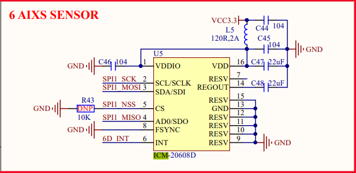
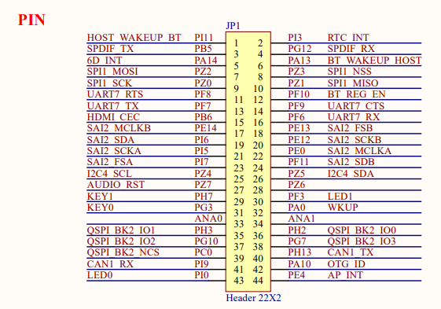

# `pinctrl`和`gpio`子系统

## 1、`pin`配置信息讲解

​	要使用`pinctrl`子系统，我们需要在设备树里面设置`PIN`的配置信息，毕竟`pinctrl`子系统要根据你提供的信息来配置`PIN`功能，一般会在设备树里面创建一个节点来描述`PIN`的配置信息。打开`stm32mp151.dtsi`文件，存在如下节点：

```
pinctrl: pin-controller@50002000 {
	#address-cells = <1>;
	#size-cells = <1>;
	compatible = "st,stm32mp157-pinctrl";
	ranges = <0 0x50002000 0xa400>;
	interrupt-parent = <&exti>;
	st,syscfg = <&exti 0x60 0xff>;
	hwlocks = <&hsem 0 1>;
	pins-are-numbered;
	/* ... */
};
```

​	第5行，`ranges`属性表示`STM32MP1`的`GPIO`相关寄存器起始地址，`STM32MP1`系列芯片最多拥有176个通用的`GPIO`，分为12组，分别为：`PA0-PA15`、`PB0-PB15`、`PC0-PC15`、`PD0-PD15`、`PE0-PE15`、`PF0-PF15`、`PG0-PG15`、`PH0-PH15`、`PI0-PI15`、`PJ0-PJ15`、`PK0-PK7`、`PZ0-PZ7`。

​	其中`PA-PK`这11组`GPIO`的寄存器在一块，起始地址为`0x50002000`，终止地址为`0x5000C3FF`。`PZ`组`GPIO`寄存器的起始地址为`0x54004000`，所以`stm32mp151.dtsi`文件里还有一个名为`pinctrl_z`的子节点。每一组的`GPIO`的寄存器的长度均为`0x400`。

> ​	注意，`PA-PK`这11组`GPIO`的寄存器并不是连续的，`PA`组`GPIO`的寄存器地址段为`0x50002000-0x50002400`，`PB`组`GPIO`的寄存器地址段为`0x50003000-50003400`。

​	

​	查看`stm32mp15-pinctrl.dtsi`文件，存在如下`pin`相关配置信息：

```
spi1_pins_a: spi1-0 {
                pins1 {
                        pinmux = <STM32_PINMUX('Z', 0, AF5)>, /* SPI1_SCK */
                                 <STM32_PINMUX('Z', 2, AF5)>; /* SPI1_MOSI */
                        bias-disable;
                        drive-push-pull;
                        slew-rate = <1>;
                };

                pins2 {
                        pinmux = <STM32_PINMUX('Z', 1, AF5)>; /* SPI1_MISO */
                        bias-disable;
                };

                pins3 {
                        pinmux = <STM32_PINMUX('Z', 3, GPIO)>; /* SPI1_NSS */
                        drive-push-pull;
                        bias-pull-up;
                        output-high;
                        slew-rate = <0>;
                };
        };
```

​	不同的外设使用的`PIN`不同，其配置也不同，通常将某个外设使用的所有`PIN`都组织在一个节点里，如上述代码中的`spi1_pins_a`节点。

**1.`pinmux`**

​	此属性用来存放外设所要使用的所有`IO`，以如下代码举例：

```
pinmux = <STM32_PINMUX('Z', 3, GPIO)>; /* SPI1_NSS */
```

​	可以看出，这里使用`STM32_PINMUX`宏来配置引脚的复用功能，此宏定义在`include/dt-bindings/pinctrl/stm32-pinfunc.h`文件里，内容如下：

```c
/*  define PIN modes */
#define GPIO    0x0
#define AF0     0x1
#define AF1     0x2
#define AF2     0x3
#define AF3     0x4
#define AF4     0x5
#define AF5     0x6
#define AF6     0x7
#define AF7     0x8
#define AF8     0x9
#define AF9     0xa
#define AF10    0xb
#define AF11    0xc
#define AF12    0xd
#define AF13    0xe
#define AF14    0xf
#define AF15    0x10
#define ANALOG  0x11
#define RSVD    0x12

#define PIN_NO(port, line) (((port) - 'A') * 0x10 + (line))

#define STM32_PINMUX(port, line, mode) (((PIN_NO(port, line)) << 8) | (mode))
```

​	`port`：表示用那一组`GPIO`。

​	`line`：表示用这一组`GPIO`的第几个引脚。

​	`mode`：表示用这一个引脚的哪个复用功能。

> ​	不难发现，`pinmux`最后展开计算出来是一个数，如`pinmux = <STM32_PINMUX('Z', 3, GPIO)>`展开后为`pinmux = <0x19300>`

​	

​	我们可以通过查询`《STM32MP15x底板原理图V1.5.pbf》`知道想要使用的设备应该配置哪些`pin`。比如我要使用`SPI`控制器下接的`ICM-20608`设备。





​	可以发现，`ICM-20608`设备是接在`SPI1`控制器下的，而`SPI1`控制器的各引脚对应关系如下：`SPI1_SCK--PZ0`、`SPI1_MISO--PZ1`、`SPI1_MOSI--PZ2`、`SPI1_NSS--PZ3`。所以我们需要配置`PZ0-3`的`GPIO`的复用。

​	

​	我们可以通过查询`《STM32MP157A&D数据手册.pbf》`知道想要使用的设备应该如何配置`pin`复用。


​	可以看出，我们需要配置`PZ0`使用`AF5`这个复用功能，`PZ1-PZ3`同理。

> ​	不难发现，`PZ0`除了可以做`SPI1_SCK`功能，还能做`I2C2_SCL`功能，因此我们还可以在`stm32mp15-pinctrl.dtsi`文件中发现如下描述：
>
> ```
> pinmux = <STM32_PINMUX('Z', 0, AF3)>; /* I2C2_SCL */
> ```
>
> ​	`pinctrl`驱动只会把设备树中`pinctrl`节点解析出来的数据存储到一个链表里，只有在使用某个外设并且这个外设调用这个`pinctrl`节点的时候才会真的使用。所以，在设备树里描述`PZ0`做多个功能并不会引起冲突。
>
> ​	如果你同时使用`I2C2`和`SPI1`，并且它们都同时用到了`PZ0`的功能复用，那就会出问题。而如果你首先使用了`I2C2`，然后关闭该设备，再使用`SPI1`，则不会出问题。
>
> ​	为了方便开发，建议一个`PIN`最好只能被一个外设使用。
>
> 
>
> ​	其实，通过查询`《STM32MP157A&D数据手册.pbf》`会发现`SPI1_NSS`是`PZ3`的`AF5`复用功能，那么在使用`SPI1_NSS`的时候到底是复用`AF5`还是`GPIO`功能呢？笔者此处存疑，后续补充。
>
> ​	
>
> ​	按道理来讲，当我们将一个`IO`用作`GPIO`功能的时候也需要创建对应的`pinctrl`节点，并且将所用的`IO`复用为`GPIO`功能，比如将`PI0`复用为`GPIO`的时候就需要设置`pinmux`属性为：`<STM32_PINMUX('Z', 3, GPIO)>`，但是！对于`STM32MP1`而言，如果一个`IO`用作`GPIO`功能 的时候不需要创建对应的`pinctrl`节点！也就是说，`SPI1_NSS`的复用可以不在设备树中进行描述。

**2.电气属性配置**

​	电气属性不同于`pinmux`属性，其在`pinctrl`子系统里不是必须的，可以不配置。`stm32-pinctrl.yaml`文件中描述了如何设置电气属性，如下表：

| 电气特性属性       | 类型       | 作用                                        |
| ------------------ | ---------- | ------------------------------------------- |
| `bias-disable`     | `bootlean` | 禁止使用内部偏置电压                        |
| `bias-pull-down`   | `bootlean` | 内部下拉                                    |
| `bias-pull-up`     | `bootlean` | 内部上拉                                    |
| `drive-push-pull`  | `bootlean` | 推挽输出                                    |
| `drive-open-drain` | `bootlean` | 开漏输出                                    |
| `output-low`       | `bootlean` | 输出低电平                                  |
| `output-high`      | `bootlean` | 输出高电平                                  |
| `slew-rate`        | `enum`     | 引脚的速度，可设置：0-3，<br />0最慢，3最快 |

## 2、`gpio`

​	`pinctrl`子系统重点是设置`PIN`（有的`SOC`叫做`PAD`）的复用和电气属性，如果`pinctrl`子系统复用为`GPIO`功能的话，就需要用到`GPIO`子系统。

```
pin-controller@50002000 {
	#address-cells = <0x1>;
	#size-cells = <0x1>;
	compatible = "st,stm32mp157-pinctrl";
	/* ... */

	gpio@50003000 {
		gpio-controller;
		#gpio-cells = <0x2>;
		interrupt-controller;
		#interrupt-cells = <0x2>;
		reg = <0x1000 0x400>;
		clocks = <0xe 0x55>;
		st,bank-name = "GPIOB";
		status = "okay";
		ngpios = <0x10>;
		gpio-ranges = <0x7a 0x0 0x10 0x10>;
	};
};
```

​	第7-19行就是`GPIOA`的控制器信息，属于`pinctrl`的子节点，对于`STM32MP1`而言，`pinctrl`和`gpio`这两个子系统的驱动文件是一样的，都是`pinctrl-stm32mp157.c`，所以在注册`pinctrl`驱动的时候也会注册`gpio`驱动。

​	第9行，`#gpio-cells`属性和`address-cells`类似，`#gpio-cells = <0x2>`表示一共有两个`cell`，第一个`cell`为`GPIO`编号，如`&gpioz 0`就表示`PZ0`（注意`&gpioz 0`为一个`cell`而不是两个）。第二个`cell`表示`GPIO`极性，0表示高电平有效（`GPIO_ACTIVE_HIGH`），1表示低电平有效（`GPIO_ACTIVE_LOW`）。

​	第12行，`reg`属性设置了`GPIOB`控制器的寄存器基地址偏移量为`0x1000`，因此`GPIOB`寄存器地址为`0x50002000 + 0x1000 = 0x50003000`。