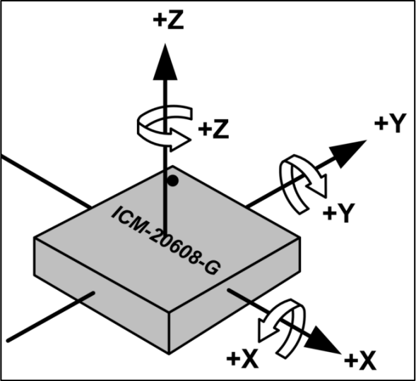
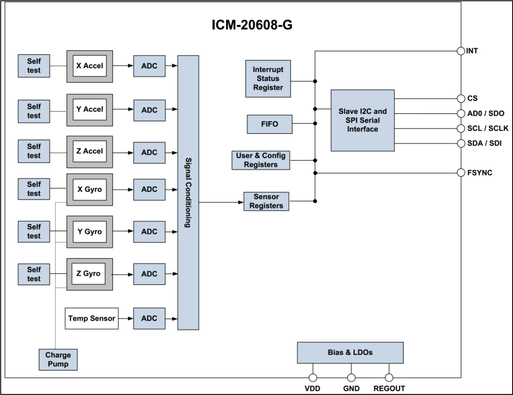
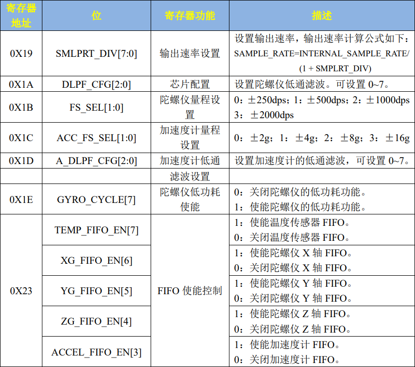
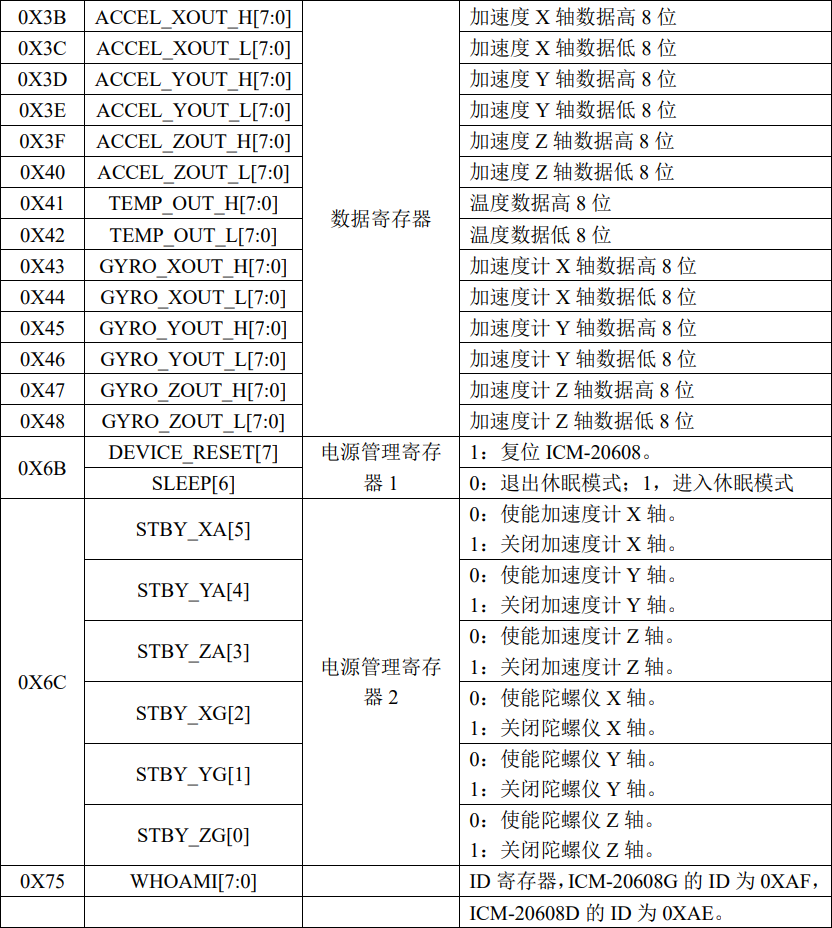
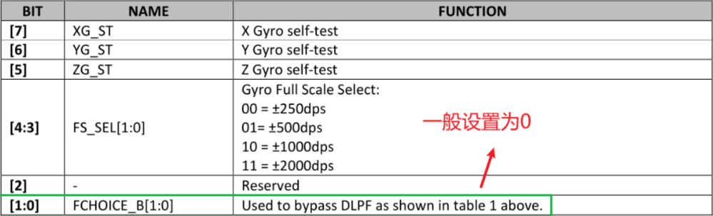

# `SPI`接`icm20608`设备

## 1、`ICM-10608`设备简介

​	`ICM-20608`是`InvenSense`出品的一款6轴`MEMS`传感器，包括3轴加速度和3轴陀螺仪。`ICM-20608`的尺寸非常小，只有`3x3x0.75mm`，采用`16P`的`LGA`封装。`ICM-20608`内部有一个512字节的`FIFO`。陀螺仪的量程范围可以编程设置，可选择`±250`、`±500`、`±1000`、`±2000°/s`，加速度的量程范围也可以编程设置，可选择`±2g`、`±4g`、`±8g`、`±16g`。陀螺仪和加速度计都是16位的ADC，并且支持`I2C`和`SPI`两种协议，使用`I2C`接口的话通信速度最高可以达到`400KHz`，使用`SPI`接口的话通信速度最高可达到`8MHz`。开发板上的`ICM-20608`通过`SPI`接口和`STM32MP157`连接在一起。`ICM-20608`特性如下：

​	1）陀螺仪支持`X`、`Y`和`Z`三轴输出，内部集成16位`ADC`，测量范围可设置：`±250`、`±500`、`±1000`、`±2000°/s`。

​	2）加速度计支持`X`、`Y`和`Z`三轴输出，内部集成16位`ADC`，测量范围可设置：`±2g`、`±4g`、`±8g`、`±16g`。

​	3）用户可编程中断。

​	4）内部包含512字节的`FIFO`。

​	5）内部包含一个数字温度传感器。

​	6）耐`10000g`的冲击。

​	7）支持快速`I2C`，速度可达`400KHz`。

​	8）支持`SPI`，速度可达`8MHz`。

​	`ICM-20608`的3轴方向如下图所示：



​	`ICM-20608`的结构框图如下图所示：



​	如果使用`I2C`接口的话，`ICM-20608`的`AD0`引脚决定`I2C`设备从地址的最后一位，如果`AD0`为0的话`ICM-20608`从设备地址是`0x68`，如果`AD0`为1的话`ICM-20608`从设备地址为`0x69`。

​	本文使用`SPI`接口，通过读写寄存器来配置和读取传感器数据，使用`SPI`接口读写寄存器需要16个时钟或者更多（如果读写操作包括多个字节的话），第一个字节包含要读写的寄存器地址，寄存器地址最高位是读写标志位，为1的话表示读寄存器，为0的话表示写寄存器，剩下的7位才是实际的寄存器地址。后面的字节就是读写的数据。下表列出了一些用到的寄存器，关于`ICM-20608`的详细寄存器的介绍请参考`ICM-20608`的寄存器手册：





> ​	注意，上表中的“位”一列并非我们一般逻辑的寄存器的“位”。如`0x1B`寄存器的位`FS_SEL[1:0]`在寄存器中的位置是`bit[4:3]`，而非`bit[1:0]`，如下：
>
> 

## 2、编写`ICM-20608`驱动

### 2.1 库文件

```C
#ifndef ICM20608_H
#define ICM20608_H
#define ICM20608G_ID			0XAF
#define ICM20608D_ID			0XAE

#define	ICM20_SELF_TEST_X_GYRO		0x00
#define	ICM20_SELF_TEST_Y_GYRO		0x01
#define	ICM20_SELF_TEST_Z_GYRO		0x02
#define	ICM20_SELF_TEST_X_ACCEL		0x0D
#define	ICM20_SELF_TEST_Y_ACCEL		0x0E
#define	ICM20_SELF_TEST_Z_ACCEL		0x0F

#define	ICM20_XG_OFFS_USRH			0x13
#define	ICM20_XG_OFFS_USRL			0x14
#define	ICM20_YG_OFFS_USRH			0x15
#define	ICM20_YG_OFFS_USRL			0x16
#define	ICM20_ZG_OFFS_USRH			0x17
#define	ICM20_ZG_OFFS_USRL			0x18

#define	ICM20_SMPLRT_DIV			0x19
#define	ICM20_CONFIG				0x1A
#define	ICM20_GYRO_CONFIG			0x1B
#define	ICM20_ACCEL_CONFIG			0x1C
#define	ICM20_ACCEL_CONFIG2			0x1D
#define	ICM20_LP_MODE_CFG			0x1E
#define	ICM20_ACCEL_WOM_THR			0x1F
#define	ICM20_FIFO_EN				0x23
#define	ICM20_FSYNC_INT				0x36
#define	ICM20_INT_PIN_CFG			0x37
#define	ICM20_INT_ENABLE			0x38
#define	ICM20_INT_STATUS			0x3A

#define	ICM20_ACCEL_XOUT_H			0x3B
#define	ICM20_ACCEL_XOUT_L			0x3C
#define	ICM20_ACCEL_YOUT_H			0x3D
#define	ICM20_ACCEL_YOUT_L			0x3E
#define	ICM20_ACCEL_ZOUT_H			0x3F
#define	ICM20_ACCEL_ZOUT_L			0x40

#define	ICM20_TEMP_OUT_H			0x41
#define	ICM20_TEMP_OUT_L			0x42

#define	ICM20_GYRO_XOUT_H			0x43
#define	ICM20_GYRO_XOUT_L			0x44
#define	ICM20_GYRO_YOUT_H			0x45
#define	ICM20_GYRO_YOUT_L			0x46
#define	ICM20_GYRO_ZOUT_H			0x47
#define	ICM20_GYRO_ZOUT_L			0x48

#define	ICM20_SIGNAL_PATH_RESET		0x68
#define	ICM20_ACCEL_INTEL_CTRL 		0x69
#define	ICM20_USER_CTRL				0x6A
#define	ICM20_PWR_MGMT_1			0x6B
#define	ICM20_PWR_MGMT_2			0x6C
#define	ICM20_FIFO_COUNTH			0x72
#define	ICM20_FIFO_COUNTL			0x73
#define	ICM20_FIFO_R_W				0x74
#define	ICM20_WHO_AM_I 				0x75

#define	ICM20_XA_OFFSET_H			0x77
#define	ICM20_XA_OFFSET_L			0x78
#define	ICM20_YA_OFFSET_H			0x7A
#define	ICM20_YA_OFFSET_L			0x7B
#define	ICM20_ZA_OFFSET_H			0x7D
#define	ICM20_ZA_OFFSET_L 			0x7E

struct icm20608_dev {
	struct spi_device *spi;		
	dev_t devid;
	struct cdev cdev;
	struct class *class;
	struct device *device;
	struct device_node	*nd;
	signed int gyro_x_adc;
	signed int gyro_y_adc;
	signed int gyro_z_adc;
	signed int accel_x_adc;
	signed int accel_y_adc;
	signed int accel_z_adc;
	signed int temp_adc;
};

#endif
```

### 2.2 驱动文件

#### 2.2.1 初始化和卸载

```c
static int __init icm20608_init(void)
{
	return spi_register_driver(&icm20608_driver);
}

static void __exit icm20608_exit(void)
{
	spi_unregister_driver(&icm20608_driver);
}

module_init(icm20608_init);
module_exit(icm20608_exit);
MODULE_LICENSE("GPL");
MODULE_AUTHOR("ALIENTEK");
```

#### 2.2.2 设备和驱动匹配

```c
static const struct of_device_id icm20608_of_match[] = {
	{ .compatible = "alientek,icm20608" },
	{ /* Sentinel */ }
};

static struct spi_driver icm20608_driver = {
	.probe = icm20608_probe,
	.remove = icm20608_remove,
	.driver = {
			.owner = THIS_MODULE,
		   	.name = "icm20608",
		   	.of_match_table = icm20608_of_match,
		   },
};
```

#### 2.2.3 注册和注销

**1.注册（`probe`）**

```c
static int icm20608_probe(struct spi_device *spi)
{
	int ret;
	struct icm20608_dev *icm20608dev;
	
	icm20608dev = devm_kzalloc(&spi->dev, sizeof(*icm20608dev), GFP_KERNEL);
	if(!icm20608dev)
		return -ENOMEM;
	
	ret = alloc_chrdev_region(&icm20608dev->devid, 0, ICM20608_CNT, ICM20608_NAME);
	if(ret < 0) {
		pr_err("%s Couldn't alloc_chrdev_region, ret=%d\r\n", ICM20608_NAME, ret);
        return 0;
	}

	icm20608dev->cdev.owner = THIS_MODULE;
	cdev_init(&icm20608dev->cdev, &icm20608_ops);
	
	ret = cdev_add(&icm20608dev->cdev, icm20608dev->devid, ICM20608_CNT);
	if(ret < 0) {
		goto del_unregister;
	}
	
	icm20608dev->class = class_create(THIS_MODULE, ICM20608_NAME);
	if (IS_ERR(icm20608dev->class)) {
		goto del_cdev;
	}

	icm20608dev->device = device_create(icm20608dev->class, NULL, icm20608dev->devid, NULL, ICM20608_NAME);
	if (IS_ERR(icm20608dev->device)) {
		goto destroy_class;
	}
	icm20608dev->spi = spi;
	
	spi->mode = SPI_MODE_0;	
	spi_setup(spi);
	
	icm20608_reginit(icm20608dev);	
	spi_set_drvdata(spi, icm20608dev);

	return 0;
destroy_class:
	device_destroy(icm20608dev->class, icm20608dev->devid);
del_cdev:
	cdev_del(&icm20608dev->cdev);
del_unregister:
	unregister_chrdev_region(icm20608dev->devid, ICM20608_CNT);
	return -EIO;
}
```

​	第3-32行是字符设备的自动创建的基本流程，笔者不做赘述。

​	第38行，对`ICM-20608`设备做寄存器的初始化，如下：

```c
void icm20608_reginit(struct icm20608_dev *dev)
{
	u8 value = 0;
	
	icm20608_write_onereg(dev, ICM20_PWR_MGMT_1, 0x80);
	mdelay(50);
	icm20608_write_onereg(dev, ICM20_PWR_MGMT_1, 0x01);
	mdelay(50);

	value = icm20608_read_onereg(dev, ICM20_WHO_AM_I);
	printk("ICM20608 ID = %#X\r\n", value);	

	icm20608_write_onereg(dev, ICM20_SMPLRT_DIV, 0x00);
	icm20608_write_onereg(dev, ICM20_GYRO_CONFIG, 0x18);
	icm20608_write_onereg(dev, ICM20_ACCEL_CONFIG, 0x18);
	icm20608_write_onereg(dev, ICM20_CONFIG, 0x04);
	icm20608_write_onereg(dev, ICM20_ACCEL_CONFIG2, 0x04);
	icm20608_write_onereg(dev, ICM20_PWR_MGMT_2, 0x00);
	icm20608_write_onereg(dev, ICM20_LP_MODE_CFG, 0x00);
	icm20608_write_onereg(dev, ICM20_FIFO_EN, 0x00);
}
```

**2.注销（`remove`）**

```c
static int icm20608_remove(struct spi_device *spi)
{
	struct icm20608_dev *icm20608dev = spi_get_drvdata(spi);
	cdev_del(&icm20608dev->cdev);
	unregister_chrdev_region(icm20608dev->devid, ICM20608_CNT); 
	device_destroy(icm20608dev->class, icm20608dev->devid);
	class_destroy(icm20608dev->class); 
	return 0;
}
```

​	第3-7行是字符设备注销时的基本流程，笔者不做赘述。

#### 2.2.4 读写操作

```c
static const struct file_operations icm20608_ops = {
	.owner = THIS_MODULE,
	.open = icm20608_open,
	.read = icm20608_read,
	.release = icm20608_release,
};
```

​	用户空间只需要获取加速度、温度等信息，而不需要对该设备进行任何写操作，所以`file_operation`中不需要定义写函数。

> ​	当然，我们也可以去自定义一个写操作函数，使得用户空间可以去修改量程，设置输出速率等。

**1.写操作**

​	尽管用户空间不需要对设备进行任何写操作，但是在设备初始化的时候驱动还是需要去配置寄存器的，所以写寄存器函数还是需要的。

```c
static s32 icm20608_write_regs(struct icm20608_dev *dev, u8 reg, u8 *buf, u8 len)
{
	int ret = -1;
	unsigned char *txdata;
	struct spi_message m;
	struct spi_transfer *t;
	struct spi_device *spi = (struct spi_device *)dev->spi;
	
	t = kzalloc(sizeof(struct spi_transfer), GFP_KERNEL);
	if(!t) {
		return -ENOMEM;
	}
	
	txdata = kzalloc(sizeof(char)+len, GFP_KERNEL);
	if(!txdata) {
		goto out1;
	}
	
	*txdata = reg & ~0x80;
    memcpy(txdata+1, buf, len);
	t->tx_buf = txdata;
	t->len = len+1;
	spi_message_init(&m);
	spi_message_add_tail(t, &m);
	ret = spi_sync(spi, &m);
    if(ret) {
        goto out2;
    }
	
out2:
	kfree(txdata);	
out1:
	kfree(t);
	return ret;
}

static unsigned char icm20608_read_onereg(struct icm20608_dev *dev, u8 reg)
{
	u8 data = 0;
	icm20608_read_regs(dev, reg, &data, 1);
	return data;
}
```

​	对于`ICM-20608`设备来说，可以发送信号同时写多个连续的寄存器，也可以发送信号同时读取多个连续的寄存器。不过由于写寄存器操作只存在于设备初始化的时候，而且配置的寄存器并不多，所以本文采用的是一次写一个寄存器的操作。而在后面读寄存器数据的时候，会发现所采用的是一次读多个连续的寄存器。

​	第19行，前文提到过，第一个字节组成为：`bit[7]`表示读或者写，`bit[6:0]`表示寄存器偏移量地址。

​	第20行，第一个字节后为数据，即写寄存器的值。第21-25行，将发送的数据放在`t->tx_buf`中并通过`spi_sync()`函数发送出去。

**2.读操作**

​	用户空间需要读取加速度、温度等数据，而这些数据又放在数据寄存器（`0x3B-0x48`）中，所以读数据的本质上还是读寄存器，其操作和写寄存器类似。

```c
static ssize_t icm20608_read(struct file *filp, char __user *buf, size_t cnt, loff_t *off)
{
	signed int data[7];
	long err = 0;
	struct cdev *cdev = filp->f_path.dentry->d_inode->i_cdev;
	struct icm20608_dev *dev = container_of(cdev, struct icm20608_dev, cdev);
            
	icm20608_readdata(dev);
	data[0] = dev->gyro_x_adc;
	data[1] = dev->gyro_y_adc;
	data[2] = dev->gyro_z_adc;
	data[3] = dev->accel_x_adc;
	data[4] = dev->accel_y_adc;
	data[5] = dev->accel_z_adc;
	data[6] = dev->temp_adc;
	err = copy_to_user(buf, data, sizeof(data));
	return 0;
}
```

​	第5-6行，根据`filp`获取`dev`，当然我们也可以将`struct icm20608_dev`结构体设置成全局变量，这样就可以直接使用，但是同时也会存在一定风险，所以建议还是按上述代码逻辑去获取`struct icm20608_dev`结构体。

> ​	此外，还有另一种常见的方式来获取`struct icm20608_dev`结构体，那就是在`open()`函数中直接通过`inode`通过同样的方法获取到`struct icm20608_dev`结构体，再将其设置为`filp->private_data`。然后我们就可以在`read()`、`write()`等函数中直接使用`filp->private_data`获取到`struct icm20608_dev`结构体。

​	第8-16行，读数据并将读出的数据拷贝到用户空间。


```c
void icm20608_readdata(struct icm20608_dev *dev)
{
	unsigned char data[14];
	icm20608_read_regs(dev, ICM20_ACCEL_XOUT_H, data, 14);

	dev->accel_x_adc = (signed short)((data[0] << 8) | data[1]); 
	dev->accel_y_adc = (signed short)((data[2] << 8) | data[3]); 
	dev->accel_z_adc = (signed short)((data[4] << 8) | data[5]); 
	dev->temp_adc    = (signed short)((data[6] << 8) | data[7]); 
	dev->gyro_x_adc  = (signed short)((data[8] << 8) | data[9]); 
	dev->gyro_y_adc  = (signed short)((data[10] << 8) | data[11]);
	dev->gyro_z_adc  = (signed short)((data[12] << 8) | data[13]);
}
```

​	第4行，连续读取从`0x3B`偏移量地址开始的14个寄存器的值，即`0x3B-0x48`。

​	第6-12行，对读取的寄存器数据进行移位处理。


```c
static int icm20608_read_regs(struct icm20608_dev *dev, u8 reg, void *buf, int len)
{

	int ret = -1;
	unsigned char txdata[1];
	unsigned char * rxdata;
	struct spi_message m;
	struct spi_transfer *t;
	struct spi_device *spi = (struct spi_device *)dev->spi;
    
	t = kzalloc(sizeof(struct spi_transfer), GFP_KERNEL);
	if(!t) {
		return -ENOMEM;
	}
	rxdata = kzalloc(sizeof(char) * len, GFP_KERNEL);
	if(!rxdata) {
		goto out1;
	}

	txdata[0] = reg | 0x80;
	t->tx_buf = txdata;	
    t->rx_buf = rxdata;
	t->len = len+1;	
	spi_message_init(&m);
	spi_message_add_tail(t, &m);
	ret = spi_sync(spi, &m);
	if(ret) {
		goto out2;
	}
	
    memcpy(buf , rxdata+1, len);

out2:
	kfree(rxdata);
out1:	
	kfree(t);
	
	return ret;
}
```

​	和写寄存器函数类似，笔者不做赘述。

## 3、测试程序

```c
int main(int argc, char *argv[])
{
	int fd;
	char *filename;
	signed int databuf[7];
	unsigned char data[14];
	signed int gyro_x_adc, gyro_y_adc, gyro_z_adc;
	signed int accel_x_adc, accel_y_adc, accel_z_adc;
	signed int temp_adc;

	float gyro_x_act, gyro_y_act, gyro_z_act;
	float accel_x_act, accel_y_act, accel_z_act;
	float temp_act;

	int ret = 0;

	if (argc != 2) {
		printf("Error Usage!\r\n");
		return -1;
	}

	filename = argv[1];
	fd = open(filename, O_RDWR);
	if(fd < 0) {
		printf("can't open file %s\r\n", filename);
		return -1;
	}

	while (1) {
		ret = read(fd, databuf, sizeof(databuf));
		if(ret == 0) { 			/* 数据读取成功 */
			gyro_x_adc = databuf[0];
			gyro_y_adc = databuf[1];
			gyro_z_adc = databuf[2];
			accel_x_adc = databuf[3];
			accel_y_adc = databuf[4];
			accel_z_adc = databuf[5];
			temp_adc = databuf[6];

			/* 计算实际值 */
			gyro_x_act = (float)(gyro_x_adc)  / 16.4;
			gyro_y_act = (float)(gyro_y_adc)  / 16.4;
			gyro_z_act = (float)(gyro_z_adc)  / 16.4;
			accel_x_act = (float)(accel_x_adc) / 2048;
			accel_y_act = (float)(accel_y_adc) / 2048;
			accel_z_act = (float)(accel_z_adc) / 2048;
			temp_act = ((float)(temp_adc) - 25 ) / 326.8 + 25;

			printf("\r\n原始值:\r\n");
			printf("gx = %d, gy = %d, gz = %d\r\n", gyro_x_adc, gyro_y_adc, gyro_z_adc);
			printf("ax = %d, ay = %d, az = %d\r\n", accel_x_adc, accel_y_adc, accel_z_adc);
			printf("temp = %d\r\n", temp_adc);
			printf("实际值:");
			printf("act gx = %.2f°/S, act gy = %.2f°/S, act gz = %.2f°/S\r\n", gyro_x_act, gyro_y_act, gyro_z_act);
			printf("act ax = %.2fg, act ay = %.2fg, act az = %.2fg\r\n", accel_x_act, accel_y_act, accel_z_act);
			printf("act temp = %.2f°C\r\n", temp_act);
		}
		usleep(100000); /*100ms */
	}
	close(fd);	/* 关闭文件 */	
	return 0;
}
```


​	