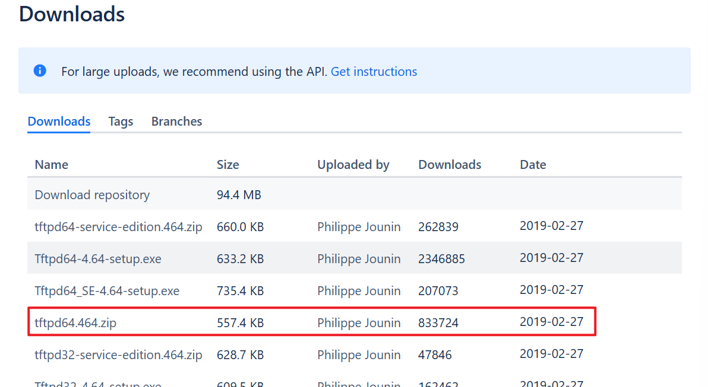
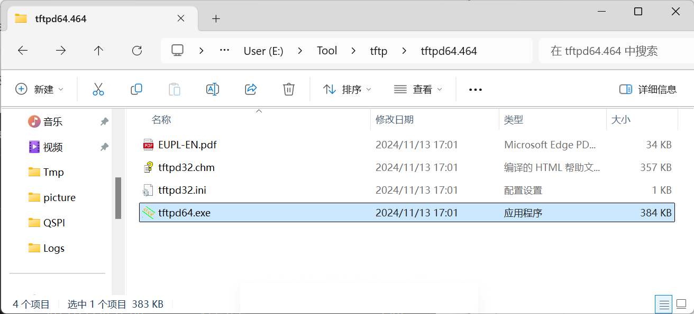
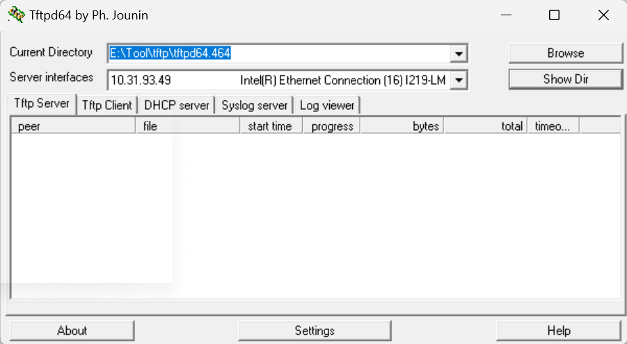
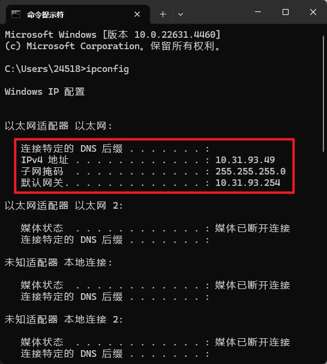
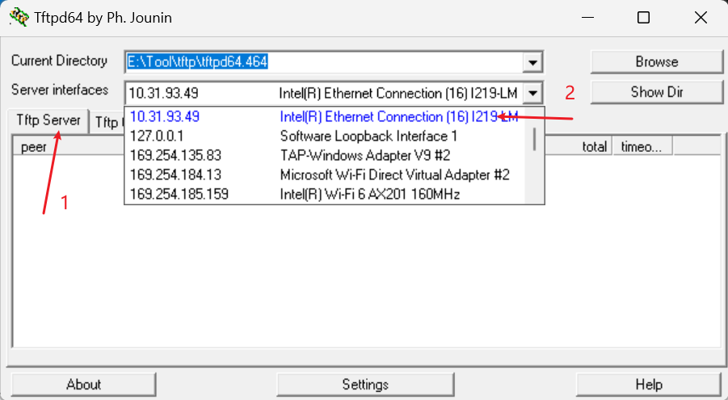
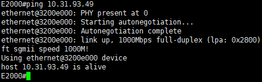
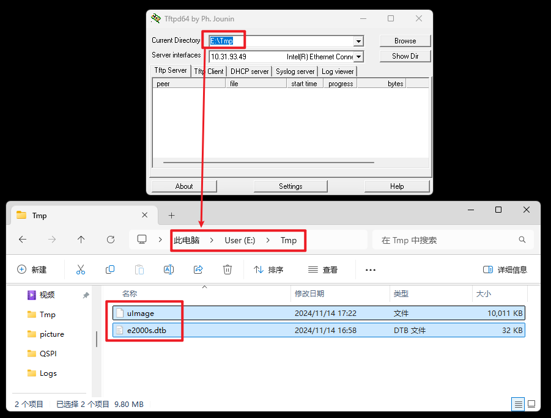
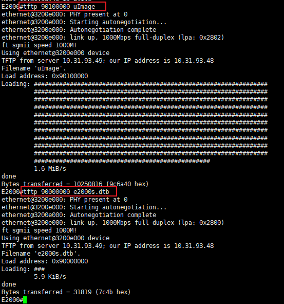

# uboot通过网络启动

> 参考链接：
>
> [uboot通过网络启动内核和根文件系统](https://www.cnblogs.com/yangjinghui/p/17655039.html)
>
> [Windows下TFTP服务器搭建及U-Boot中使用tftp命令实现文件下载](https://blog.csdn.net/weixin_44550536/article/details/131714211)


## 1、开发背景

​	由于开发阶段需要频繁修改内核镜像文件和根文件系统，如果每次修改都通过烧写`EMMC`或者`SD`卡制卡过于繁琐，通过网络启动和加载则简单很多。

## 2、开发需求

​	内核镜像文件`uImage`和设备树`dtb`存放在`Windows`的某个目录下，文件系统存放在`Ubuntu`中。

## 3、`Windows`搭建`TFTP`服务器

​	`TFTP`（`Trivial File Transfer Protocol`，简单文件传输协议）是`TCP/IP`协议族中的一个用来在客户机与服务器之间进行简单文件传输的协议，提供不复杂、开销不大的文件传输服务，端口号为69。在`uboot`中也支持`TFTP`协议，可以通过`tftp`命令从服务端下载文件。服务端可以是`Linux`或`Windows`，只要支持`TFTP`服务即可。本节主要介绍如何在`Windows`下搭建`TFTP`服务。

### 3.1 下载软件

​	`tftpd32/64`是一个集成了`DHCP`、`TFTP`、`DNS`、`SNTP`和`Syslog`多种服务的免费开源、轻量级应用程序。直接从官网下载64位免安装版（https://bitbucket.org/phjounin/tftpd64/downloads/）：



### 3.2 运行软件	

​	下载完成后解压到非中文路径下，双击运行`exe`程序即可，如下：



### 3.3 软件界面

​	软件界面非常简洁，可以看到软件支持`Tftp`服务器，`Tftp`客户端、`DHCP`服务器、`Syslog`服务器等多个功能，如下：



### 3.4 设置软件

​	我们先将开发板和`PC`机用网线连接，在`PC`机上的命令窗口输入`ipconfig`获取`IP`地址、子网掩码及默认网关，如下：



​	将打开的`Tftp64`软件配置为服务端，然后设置其服务端接口的`IP`地址为`10.31.93.49`，如下：



> ​	对于`Tftp64`软件中的`Current Directory`项，其默认为软件所在目录，可以修改为任意非中文目录，然后只需要将需要传输的文件放到该目录下即可。

## 4、`uboot`做`Tftp`客户端

### 4.1 设置参数

​	启动开发板进入`uboot`命令模式，先配置网络相关的环境变量，保证开发板`IP`和服务端`IP`要在同一网段下：

```
setenv ipaddr 10.31.93.48			# 开发板 IP 地址
setenv gatewayip 10.31.93.154		# 网关地址
setenv netmask 255.255.255.0		# 子网掩码
setenv serverip 10.31.93.49			# 服务器 IP 地址
setenv ethaddr 00:aa:bb:cc:dd:ef	# MAC地址
```

​	网关地址、子网掩码、服务器`IP`地址就是上一节中`PC`机下命令窗口输入`ipconfig`指令打印出来的。开发板`IP`地址一般取服务器`IP`地址最后一个数减一。`MAC`地址笔者暂时不清楚应该如何设置，可以在`uboot`下使用`printenv`命令打印出`ethaddr`的值，如果有，建议不做设置或修改。

### 4.2 检验网络连接是否正常

​	在`uboot`下使用`ping`命令验证一下开发板和`PC`机之间网络连接是否正常，如下：



### 4.3 下载文件

​	将内核镜像及设备树文件均放到`Tftp64`软件的`Current Directory`指定的目录下，如下：



​	在`uboot`下使用`tftp`命令下载文件到对应的`RAM`中的存放地址处（注意`tftp`命令后的地址参数默认为16进制，不需要加`0x`符号），如下：



### 4.3 启动系统

​	下载完镜像及设备树到指定地址后，`uboot`下直接输入如下指令启动系统：

```
bootm 0x90100000 -:- 0x90000000
```

