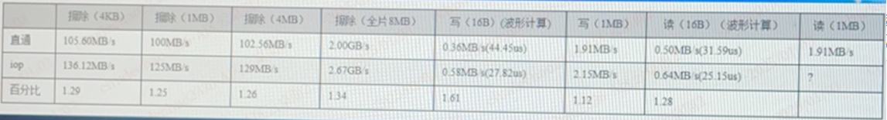

20250102

E2000：vfat和ext4文件系统挂载失败问题。原因：使用的flash电压3.3V和E2000板子上的qspi的flash插槽电压为1.8V不匹配，导致flash读写异常，从而导致文件系统挂载失败。解决方法：更换1.8V的flash后重新测试，文件系统挂载正常。

Tianji2

spi-iop：之前只测试了读写擦的基本功能，补充测试了模块卸载与重装，不同分频，不同工作模式，已完成。兼容性目前使用flash模型无法测试，因为验证使用的大部分模型本身存在问题，所以计划兼容性测试使用真实flash在X1环境上进行测试。休眠唤醒目前环境不支持测试，原因为固件不支持SE唤醒。

20250109

E2000：

1、ext4文件系统挂载失败根因：s25fs128s型号flash存在两种扇区——参数扇区（0-32KB）和统一扇区（32KB-16MB），擦除参数扇区只能使用0x20指令，擦除统一扇区只能使用0xd8指令。全片擦除指令0xc7可以实现两种扇区都擦除。内核对s25fs128s型号flash采用的是统一扇区擦除指令0xd8。做ext4文件系统格式化时，会对0-32KB进行擦写，但是使用的是0xd8擦除指令，所以会导致该段空间擦除失败，进而导致无法实现正常写操作，再导致文件系统格式化失败，最后导致ext4文件系统挂载失败。可以采用对该型号flash分区的方式，然后对分区进行ext4文件系统挂载。

2、nand驱动注册时有call trace抛出，但是nand功能测试正常。查看抛出的call trace信息，分析原因与spin_lock_init()函数有关，定位到该函数定义处发现有一个内核配置CONFIG_DEBUG_SPINLOCK，关闭该配置项后，重新测试，nand驱动注册成功且无call trace抛出，测试nand功能也正常。

Tianji2：

1、spi-iop性能测试结果如下：

2、目前使用关Cache的固件进行测试，发现走IOP和走直通的时间相差较大。原因待查

20250116

1、E2000：nand驱动注册时有call trace抛出问题。根因：在nand驱动注册时，锁的初始化代码（spin_lock_init）在锁的使用代码（spin_lock）之后，导致未进行锁的初始化就直接使用锁。解决方法：在使用锁之前对锁进行初始化。重新测试后不再有call trace抛出，且nand功能测试正常。

2、D2000：西安威嵌在qspi控制器下接4片256MB大小flash时，访问后两个flash报错。原因：D2000的qspi直接映射空间大小为512MB，采用直接方式最大只能支持2个256MB的flash。解决方法：建议西安威嵌1）采用4个128MB大小flash；2）使用两个256MB大小flash；3）使用间接方式。西安威嵌采用建议3并测试正常。

3、文档：完成《qspi测试用例.docx》及《spi测试用例.docx》，待后续评审

20250123

1、学习eBPF和trace开发，尝试编写eBPF程序对cpu利用率监测追踪。

2、E2000（BMC）：客户（昆仑）使用5.15内核在系统启动时报qspi异常，能识别到qspi flash并正常做分区，但是在读flash中的数据时出现异常。使用4.19内核能正常启动。原因待查。

20250206

E2000S（BMC）：使用5.15内核在BMC和系统同时启动时报call trace异常问题（涉及qspi读数据函数）。怀疑读数据的地址可能出现越界，后加打印查看读地址未出现越界。后续将qspi控制器寄存器状态读取出来与4.19下寄存器状态做对比，查看是否存在异常。

20250213

1、D3000M：测试spi-v2的擦除时使用mtd_debug工具擦除出现擦除1MB大小最后只能擦除4KB大小空间，使用flash_erase工具擦除正常。分析mtd_debug和flash_erase工具源码，发现两者的擦除逻辑略有不同。flash_erase工具在用户态就会做4KB拆分，而mtd_debug工具是在spi core层做4KB拆分。修改驱动代码后重新测试，使用mtd_debug工具擦除正常。

2、S5000C：80核学校测试题使用6.6.0版本内核测试时报段错误异常，使用5.15及5.10内核跑相同的测试题正常。目前正搭建环境进行复现。

20250220

1、D3000M：D3000M测试flash全片擦除时报RV侧指令超时错误。分析驱动代码，报错原因为RV侧返回的状态码为4，即“Operating flash timeout”，问题原因与驱动无关。分析RV侧代码，发现RV侧等待指令完成的超时时间设置太小。重新修改RV侧代码增加该超时时间后重新测试，进行中。

2、Tianji2：helium环境测试间接四线读写时，发现读数据异常，写数据正常。抓取波形发现读数据波形IO0-3均有信号，说明四线设置成功，但是抓取读数据信号中缺少延时的dummy信号，查询寄存器状态发现未配置读数据延时寄存器。重新修改驱动代码后进行测试，结果正常。

3、Tianji2：helium环境测试直接四线读写时数据异常。先定位写数据异常的原因。查看0x08和0x10寄存器的值并未发现异常，抓取IO0-3信号也确实向falsh写了数据，但是确认状态指令（0x05）返回的状态不对。原因待查。

20250227

Tianji2：测试qspi-v2间接读打开reg_constant功能。打开和关闭reg_constant功能测试均已完成，根据数据长度判断是否启用该功能，超过8字节则启用，反正则关闭。（关闭reg_constant：传统间接读，一次传输8bytes数据。打开reg_constant：存在256字节大小的buffer，通过中断方式去读取）

Tianji2：测试qspi-v2直接写打开wip（写完成状态）查询功能。测试中。（关闭wip查询：cpu主动查询wip。打开wr_wait：控制器自动查询wip状态，通过中断方式告知cpu）

D3000m：1）rasdaemon测试。2）飞腾自定义平台类型错误的报错。3）rasdaemon工具的开发。（使其能够抓取到飞腾自定义平台类型错误）

目前进展：搭建环境中。使用普通系统盘无法启动，目前固件只能适配v9版本内核。

D3000m：uboot-ras测试。（硬件注错）通过写特定寄存器的方式完成ras中断功能的测试，测试结果正常，能够上报ras错误。后续还需要测试EINJ接口（软件注错），目前提供的固件未描述EINJ表，需要重新提供新的固件以便进行后续测试。

S6000：使用EINJ接口进行核注错时OS未生成EINJ接口。查看dmesg发现固件未描述RAS所需要的APEI表。

20250306

3000M：qspi下挂4片flash时，能生成对应mtd设备，但是擦除读写这些设备会出现异常。原因为capacity寄存器配置错误导致直接映射地址空间与falsh实际大小不符，进而导致擦除读写出现异常。修改qspi控制器驱动正确配置capacity寄存器后测试正常。

3000M：qspi测试flash兼容性，新增三款国产flash——博雅（BY25FQ64EL）、乐存（LC25M4AA）、武汉新芯（XM25QU128C）。

1、博雅flash擦除写均异常。更换另一个同型号flash后测试正常，分析原因可能为flash损坏或打开了写保护。

2、乐存和武汉新芯的flash擦除速度较慢（数据全0时擦除耗时110s左右，有数据时擦除时间120s左右）（常用兆易创新或华邦的flash，在数据全0时擦除耗时2-5s，有数据时擦除时间30-40s）。分析为flash本身的原因。

D3000m：1）rasdaemon测试。2）飞腾自定义平台类型错误的报错。3）rasdaemon工具的开发。（使其能够抓取到飞腾自定义平台类型错误）

目前进展：能够进行ras的注错与报错（包括phytium plat自定义的ras错误），但是rasdaemon工具无法抓取到trace_event。将工具拷贝到S5000C环境上，使用5.15内核则可以抓取到trace_event。后续计划，在S5000C上使用6.6内核启动并运行rasdaemon工具，查看是否能够抓取trace_event

Tianji2：helium环境上qspi直通与iop基本功能测试完成（包括直接/间接读写，单线/四线传输，开启reg_constant功能，开启wip功能等）。目前进展：在soc环境上进行性能测试时，iop写数据性能与直通相比较差，抓取波形发现直通只会在发送写指令后读取状态寄存器，而iop会在写使能、写指令后都进行读取状态寄存器。

20250313

D3000M：D3000m：1）飞腾自定义平台类型错误的报错，已完成，内核补丁已提交至6.6分支。2）rasdaemon工具的开发与测试，已完成。目前0-52共53种ras错误均记录在ras_mc_event.db数据库文件中，并已将数据库文件提供给贾仪伦。

D3000M：qspi性能测试：qspi直接读性能与直通相比较差（关闭wip功能时iop读性能为直通的20%），抓取波形后发现直通读为一次性读取，而iop方式下读取会按8字节拆分。原因为从直接映射地址拷贝时，直通为8字节拷贝，iop为4字节拷贝。由于rv核本身为32位，不支持64位拷贝，所以无法对其拷贝函数进行优化。现寻找其它方式进行性能优化。

20250320

S6000：核注错工具问题：写系统寄存器的工具无法在6.6内核编译使用，需要寻找新版本的system-register-tool-master工具或者对现有工具进行修改使其支持6.6内核的使用。进行中。

Tianji2：完成《spi测试用例.xsl》与《qspi测试用例.xsl》编写及初步评审

S5000C-80：ACPI表中只描述qspi控制器，不描述flash，内核报错，且控制器驱动注册失败。D3000M上使用linux-6.6-v9版本测试后并未出现报错，对比v5和v9内核的qspi驱动代码发现不同，后续更新S5000C-80的内核版本重新测试。

20250327

S6000：系统寄存器读写工具开发：对system-register-tool-master工具源码进行修改，在6.6内核编译通过，并且已在S5000C-80核机器上进行测试，能够正常读写系统寄存器。已提供工具和内核给肖杰斌，等待后续其在S6000上进行测试。

D3000M：新增ddr_log_err功能：RV检测到error 发生后，会将错误定位日志信息写入DDR指定地址，然后通过中断告知AP错误产生，AP收到异常后，从DDR中指定地址取出错误定位日志。已完成AP侧代码编写，目前正在功能测试中。
