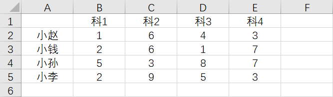
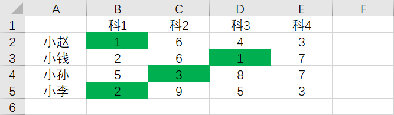
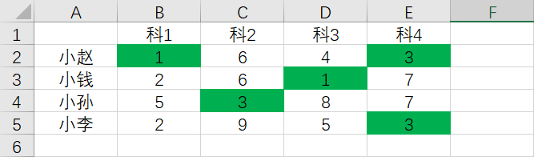
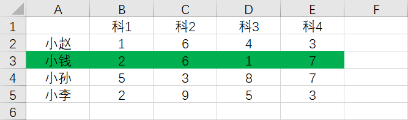
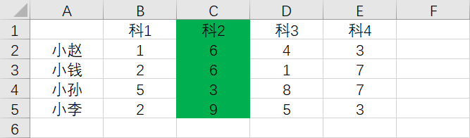

# 比较数据并填充颜色

示例：

> 公式解析：
>
> 加上符号`$`表示其后的符号或数字不会改变。
>
> `A1`：`A1`、`A2`、`A3`、`A4`、`B1`、`B2`等
>
> `$A1`：`A1`、`A2`、`A3`、`A4`
>
> `A$1`：`A1`、`B1`、`C1`、`D1`
>
> `$A$1`：`A1`

## 比较每行数据中最小值

​	需要比较出每个人考试的所有科目中得分最少的科目分数。

1. 选中需要进行比较和标色的数据区域（`B2:E5`）。
2. 点击`[开始]->[样式]->[条件格式]->[新建规则]`，选择`“使用公式确定要设置格式的单元格”`。
3. 输入以下公式：`=B2=MIN($B2:$E2)`
4. 点击`[格式]`按钮，选择`[填充]`选项卡设置为所需的颜色，最后点击`[确认]`按钮即可。

## 比较每列数据中最小值

​	需要比较每个科目的最低分数。

​	修改公式为：`=B2=MIN(B$2:B$5)`

## 比较某一列的最小值

​	如果我只想知道科3得分最少的人所有科目的考试情况。

​	步骤1中选中的区域可以不变，也可以修改为`A2:E5`

​	修改公式为：`=$D2=MIN($D$2:$D$5)`

​	如果选中的区域为`A1:E5`，则公式应该修改为：`=$D1=MIN($D$2:$D$5)`

## 比较某一行的最小值

​	如果我想知道小孙考的最少的分数的那一科目的所有人考试情况。

​	步骤1中选中的区域可以不变，也可以修改为`B1:E5`

​	修改公式为：`=B$4=MIN($B$4:$E$4)`

​	如果选中的区域为`A1:E5`，则公式应该修改为：`=A$4=MIN(B$4:$E$4)`

