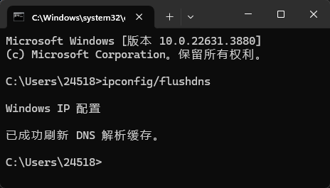

# Github无法打开

1. 打开网站[DNS查询](http://tool.chinaz.com/dns/)，在搜索栏中填写`github.com`然后检测。

2. 复制任意一个延迟较低的ip
   

3. 打开电脑文件`C:\Windows\System32\drivers\etc\host`

4. 在host文件的最后一行加入刚才复制的IP，如下：
   ```
   20.205.243.166		github.com
   ```

5. 使用`WIN+R`打开`cmd`命令窗口，执行命令`ipconfig/flushdns`
   

6. 再次访问`github.com`即可