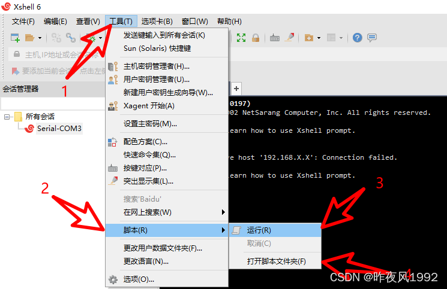

# `Xshell`脚本

## `Xshell`使用脚本




## `Xshell`脚本示例

**重启**

```
Sub Main
	'使窗口显示与当前输出同步
	xsh.Screen.Synchronous = true
	
	while(1)
		'*** WaitForString ***
		xsh.Screen.WaitForString("ft login:")	'等待目标设备发回"ft login:"字符串
		
		'*** Send ***
		xsh.Screen.Send("root")		'发送"root"字符串
		xsh.Screen.Send(VbCr)		'发送回车
		xsh.Session.Sleep(1000)		'等待1s
		
		'*** Send ***
		xsh.Screen.Send("ft123123")
		xsh.Screen.Send(VbCr)
		xsh.Session.Sleep(1000)
		
		xsh.Screen.Send("reboot")
	Wend
	
End Sub
```

