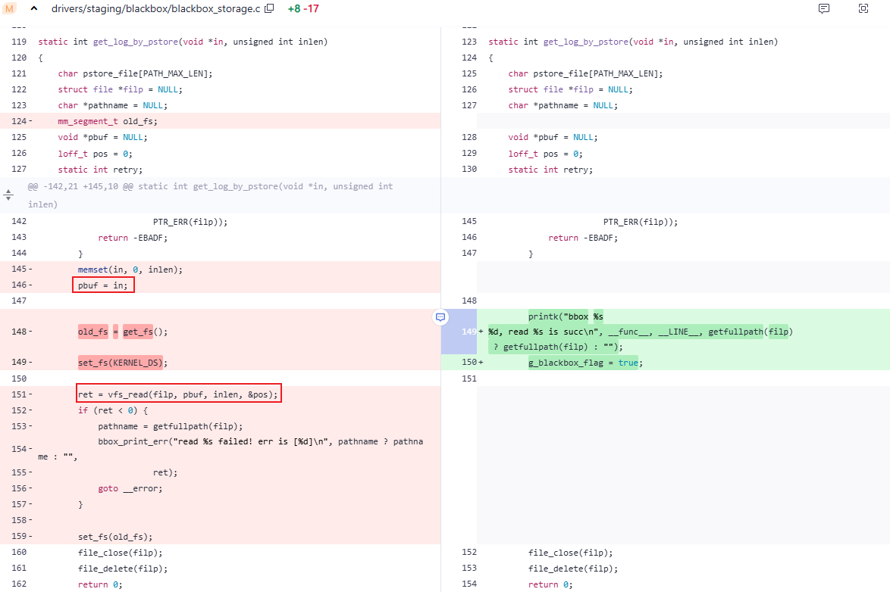
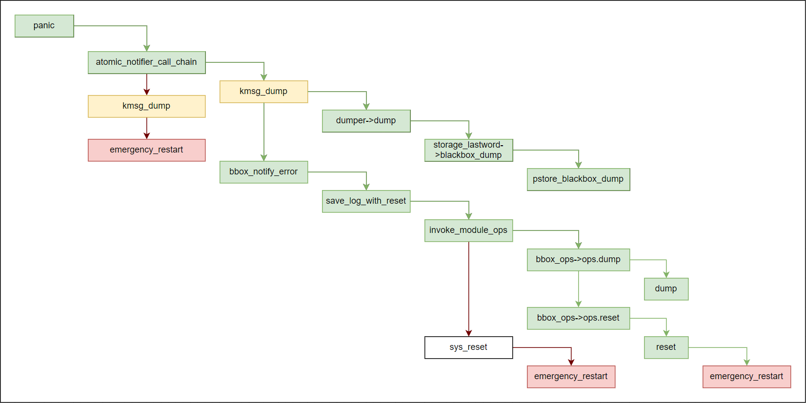
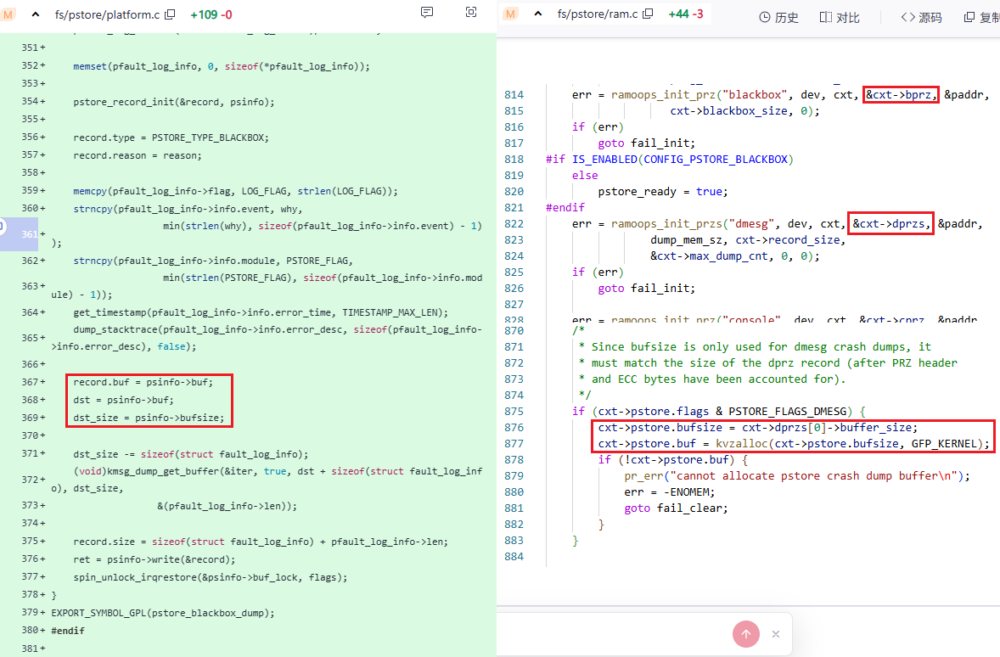

## `blackbox`

## `blackbox`初始化流程


## 其它

### `Blackbox`的日志转储功能

`pstore`默认的错误日志存储路径是`/sys/fs/pstore/`，如果其后端是`ram`，那么在断电后其中的错误日志信息就会被清除掉。`blackbox`为了改善这一状况，存在一个日志转储的功能，会将`/sys/fs/pstore/blackbox-ramoops-0`错误日志转储到诸如`U`盘或系统盘中，这样即使系统断电，日志信息也不会被清除，转储位置由内核配置`CONFIG_BLACKBOX_LOG_ROOT_PATH`和`CONFIG_BLACKBOX_LOG_PART_REPRESENTATIVE`控制。`BLACKBOX_LOG_PART_REPRESENTATIVE` 和 `BLACKBOX_LOG_ROOT_PATH` 是级递进的关系：前者指定分区（如 `/data`），后者指定该分区下的具体日志目录（如 `/data/log/bbox`）。两者配合使用，确保`blackbox`模块在故障发生时能将日志写入正确的存储位置，并在重启后从该位置恢复和读取日志。在`OpenHarmony`的实际配置中，通常需要同时设置这两个参数，例如：

```
CONFIG_BLACKBOX_LOG_ROOT_PATH="/data/log/bbox"
CONFIG_BLACKBOX_LOG_PART_REPRESENTATIVE="/data"
```


虽然`blackbox`的日志转储功能听起来很好，但是笔者发现最新的内核并没有实现该功能，即使它也有相关的配置。在解释该状况之前，读者需要先明白对于内核来说，日志的转储并不能像在`OS`下那样直接使用`cp /sys/fs/pstore/blackbox-ramoops-0 /data/log/bbox/`指令去实现，而是先读取日志数据到`buf`中，再把`buf`中的数据写到目标路径下.

为什么笔者说最新版本内核没有实现该功能，我们来看关键的影响补丁，如下：



左侧代码中`filp`就是`/sys/fs/pstore/blackbox-ramoops-0`错误日志，`pbuf`（即`in`）就是错误日志中被读出的数据，其后续会被写入`CONFIG_BLACKBOX_LOG_ROOT_PATH`设置好的路径（如`/data/log/bbox/`）下。

而右侧代码中并没有对`in`做任何操作，所以读出的日志数据为空，最终会报错`There's no valid fault log!`。

> 笔者在最初看到该补丁时有个疑惑，为什么不沿用该部分代码而要把它删掉呢？
>
> 因为在`vfs_read()`函数是将文件数据读取到用户态地址空间中的，而`pbuf`又是内核态地址，所以使用了`get_fs()`和`set_fs()`函数去规避地址校验。但是`get_fs()`和`set_fs()`存在严重的安全风险，从`Linux 5.10`开始就被移除了，所以`Linux 6.6`自然无法沿用原本的这块代码。
>
> 但是其实在`set_fs()/get_fs()`被移除时，内核提供了更安全、更明确的替代方案，即使用`kernel_read()`去读取文件数据到内核地址。那为什么这里没有使用呢？
>
> 因为`kernel_read()`要求文件实现`file->f_op->read_iter`并且不能实现`file->f_op->read`，而`pstore`文件系统却刚好相反，只实现了`f_op->read`而没有实现`f_op->read_iter`，如下：
>
> ```c
> static const struct file_operations pstore_file_operations = {
> 	.open		= pstore_file_open,
> 	.read		= pstore_file_read,
> 	.llseek		= pstore_file_llseek,
> 	.release	= seq_release,
> };
> 
> ssize_t __kernel_read(struct file *file, void *buf, size_t count, loff_t *pos)
> {
> 	...
> 	/*
> 	 * Also fail if ->read_iter and ->read are both wired up as that
> 	 * implies very convoluted semantics.
> 	 */
> 	if (unlikely(!file->f_op->read_iter || file->f_op->read))
> 		return warn_unsupported(file, "read");
> 	...
> }
> ```
> 值得一提的是，细心的读者会发现，使用最新版本代码时，即读不出`pstore`文件系统中的错误日志数据，同时又会用`file_delet(filp)`删除，最终导致`blackbox`相关日志不存在，这个状况当时困扰了笔者很久。
>
> 还有一点，如果`CONFIG_BLACKBOX_LOG_ROOT_PATH`和`CONFIG_BLACKBOX_LOG_PART_REPRESENTATIVE`没有设置，即为空时，是不会删除原`/sys/fs/pstore/blackbox-ramoops-0`日志文件的，这就涉及到`wait_for_log_part()`函数中的`is_log_part_mounted`，这里仅贴出两段关键的测试日志，就不详述了，感兴趣的读者可以自行了解。
>
> ```
> # 设置了CONFIG_BLACKBOX_LOG_ROOT_PATH和CONFIG_BLACKBOX_LOG_PART_REPRESENTATIVE
> [    0.125344] bbox:[info][blackbox_core.c:257] wait for log part [/data] begin!
> [    0.126778] bbox:[info][blackbox_core.c:515] [SYSTEM] is registered successfully!
> [    5.835978] bbox:[info][blackbox_core.c:262] wait for log part [/data] end!
> 
> # 没有设置CONFIG_BLACKBOX_LOG_ROOT_PATH和CONFIG_BLACKBOX_LOG_PART_REPRESENTATIVE
> [    0.125691] bbox:[info][blackbox_core.c:257] wait for log part [] begin!
> [    0.125703] bbox:[info][blackbox_core.c:262] wait for log part [] end!
> [    0.126930] bbox:[info][blackbox_core.c:510] [SYSTEM] is registered successfully!
> ```

综上所述，最新版本的代码也就干脆直接将日志读取的这部分代码直接删除掉了，也就导致日志转储功能失效。

### 为什么宕机时`is_log_part_mounted()`函数调用会导致回调栈异常

打印信息如下：
```
[   40.205229] ------------[ cut here ]------------
[   40.210025] kernel BUG at fs/buffer.c:1321!
[   40.214370] Internal error: Oops - BUG: 00000000f2000800 [#1] SMP
[   40.220704] Modules linked in: sunrpc binfmt_misc nls_iso8859_1 snd_soc_simple_card snd_soc_simple_card_utils snd_soc_es8336 onboard_usb_hub snd_seq_midi snd_soc_core snd_seq_midi_event snd_compress ac97_bus snd_pcm_dmaengine snd_rawmidi snd_seq snd_pcm aes_ce_blk snd_seq_device aes_ce_cipher crct10dif_ce snd_timer polyval_ce phytium_npu_platform(C) polyval_generic snd pwm_phytium phytium_npu(C) ghash_ce sm4_ce_gcm soundcore sm4_ce_ccm sm4_ce sm4_ce_cipher sm4 sm3_ce sm3 sha3_ce sha2_ce uio_pdrv_genirq sha256_arm64 sha1_ce uio sch_fq_codel ftv310_vpu_driver(O) ftg340(O) ftd330_drm_dc(O) ip_tables x_tables autofs4 uas usb_storage motorcomm(O) phytmac_platform ahci_platform phytmac libahci_platform i2c_phytium_platform spi_phytium_plat libahci phylink i2c_phytium_core spi_phytium_dma xhci_plat_hcd spi_phytium i2c_smbus phytium_mci_plat spi_phytium_qspi phytium_mci
[   40.300247] CPU: 7 PID: 895 Comm: bash Tainted: G        WC O       6.6.0.6.6-d3000m-v13-pm #95
[   40.309293] Hardware name: phytium D3000M/D3000M, BIOS 0 09/17/2026
[   40.315807] pstate: 204000c9 (nzCv daIF +PAN -UAO -TCO -DIT -SSBS BTYPE=--)
[   40.323045] pc : __find_get_block+0x380/0x660
[   40.327571] lr : __getblk_gfp+0x34/0x98
[   40.331554] sp : ffff8000859bb110
[   40.334993] x29: ffff8000859bb110 x28: 0000000000000000 x27: ffff002020553408
[   40.342413] x26: 0000000000001000 x25: ffff0020205fcd00 x24: 0000000000000000
[   40.349832] x23: 0000000000000008 x22: 000000000000245b x21: 000000000000245b
[   40.357251] x20: ffff0020205fcd00 x19: 0000000000000000 x18: 0000000000000000
[   40.364670] x17: 2e362e302e362e36 x16: 202020202020204f x15: 2043572020202020
[   40.372090] x14: 0000000000000000 x13: 617461642f3d656d x12: 616e3a7374736978
[   40.379508] x11: 0000000000000010 x10: 000000000000005d x9 : ffff8000804b5834
[   40.386927] x8 : ffff8000859bb3f8 x7 : 0000000000000000 x6 : 0000000000000000
[   40.394346] x5 : 0000000000000001 x4 : 0000000000000000 x3 : 0000000000000001
[   40.401765] x2 : 0000000000001000 x1 : 000000000000245b x0 : ffff0020205fcd00
[   40.409183] Call trace:
[   40.411718]  __find_get_block+0x380/0x660
[   40.415881]  __getblk_gfp+0x34/0x98
[   40.419502]  ext4_getblk+0xa4/0x318
[   40.423125]  ext4_bread_batch+0x70/0x200
[   40.427198]  __ext4_find_entry+0x154/0x540
[   40.431452]  ext4_lookup+0xa4/0x2a8
[   40.435073]  __lookup_slow+0x90/0x148
[   40.438877]  walk_component+0xe0/0x1a0
[   40.442770]  path_lookupat+0x80/0x1b0
[   40.446572]  filename_lookup+0xa0/0x1b0
[   40.450555]  kern_path+0x44/0x70
[   40.453905]  file_exists+0x5c/0xd8
[   40.457435]  bbox_notify_error+0x144/0x228
[   40.461688]  bbox_task_panic+0x88/0xc8
[   40.465579]  notifier_call_chain+0x78/0x150
[   40.469923]  atomic_notifier_call_chain+0x44/0x70
[   40.474810]  panic+0x184/0x420
[   40.477979]  sysrq_handle_crash+0x24/0x30
[   40.482143]  __handle_sysrq+0xbc/0x2f0
[   40.486035]  write_sysrq_trigger+0x108/0x1c8
[   40.490471]  proc_reg_write+0xa4/0x100
[   40.494362]  vfs_write+0xcc/0x2f8
[   40.497803]  ksys_write+0x70/0x108
[   40.501334]  __arm64_sys_write+0x24/0x38
[   40.505407]  invoke_syscall+0x78/0x108
[   40.509299]  el0_svc_common.constprop.0+0x48/0xf8
[   40.514185]  do_el0_svc+0x28/0x40
[   40.517624]  el0_svc+0x48/0x148
[   40.520883]  el0t_64_sync_handler+0x170/0x1c8
[   40.525408]  el0t_64_sync+0x1a8/0x1b0
[   40.529210] Code: 97fa730c 17ffff62 f103801f 54ffeca0 (d4210000) 
[   40.535543] ---[ end trace 0000000000000000 ]---
```

`is_log_part_mounted()`函数作用是判断`CONFIG_BLACKBOX_LOG_PART_REPRESENTATIVE=/data`配置指定的目录是否

被挂载，可以简单理解成`/data`是否存在。正常进入`OS`时，`/data`肯定是存在的，`is_log_part_mounted()`函数判断自然为`true`。但是在系统`panic`时，由于`panic`路径处于严格受限的原子上下文，禁止执行任何可能睡眠或获取锁的文件系统操作。而`is_log_part_mounted()`函数调用过程中涉及到获取`inode`锁、访问磁盘、等待`I/O`完成等操作，这些操作都可能睡眠（阻塞），在`panic`上下文中是绝对禁止的。

> 需要注意的是，出现这种情况的原因是笔者修改过`bbox_task_panic()`函数中的`bbox_notify_error()`函数参数，如下：
>
> ```c
> static int bbox_task_panic(struct notifier_block *this,
>     unsigned long event, void *ptr)
> {
>     ...
> 	/* 原代码 */
>     bbox_notify_error(EVENT_PANIC, MODULE_SYSTEM, error_desc, 1);
> 
>     /* 修改后的代码 */
> 	if (panic_timeout != 0)
>     	bbox_notify_error(EVENT_PANIC, MODULE_SYSTEM, error_desc, 1);
>     else
>         bbox_notify_error(EVENT_PANIC, MODULE_SYSTEM, error_desc, 0);
> }
> ```
>
> 如果是原本的代码逻辑，`panic`默认是直接重启，就不会走到`is_log_part_mounted()`函数处，也就不会存在问题。但是如果是修改后的代码逻辑，并且`panic_timeout = 0`，则会走到`is_log_part_mounted()`函数处。

### `Panic`后的处理流程

笔者在阅读`blackbox`相关代码的时候，发现有些函数在多处被调用，但是实际只有第一次调用的时候才发挥真正的效果，如`kmsg_dump(KMSG_DUMP_PANIC)`、`emergency_restart()`等。



### `blackbox`实际日志存储容量大小只和`record-size`相关

笔者在使用`blackbox`时，尝试拓展其存储的数据内容，在原版存储`struct fault_log_info`和`kmesg`的基础上，新增存储各部件寄存器的数据信息。由于各部件寄存器数据信息量很大（约`64MB`），笔者在测试时发现，`blackbox-ramoops-0`日志大小只有`1MB`左右，而实际上笔者在设备树中描述为`record-size = <0x100000>; blackbox-size = <0x4000000>;`，很明显`blackbox`的实际日志存储容量大小与`record-size`相对应。在笔者查阅相关代码之后，发现存在问题的代码如下：



由上面代码不难看出，`psinfo->buf`和`psinfo->bufsize`两个都是仅被用于`dmesg`的崩溃转储的，而`blackbox`在存储数据时，使用的就是`psinfo->buf`和`psinfo->bufsize`。所以最终导致`blackbox`的实际日志存储容量大小与`record-size`相对应。

为了解决该问题，笔者的建议是新增两个参数`psinfo->bbox_buf`和`psinfo->bbox_bufsize`。

### 寄存器信息保存

一些调试时遇到的问题：

1、在系统宕机保存寄存器信息时，卡在记录`GPU`寄存器信息处。

原因：`GPU`寄存器为两块分段式的地址，`fs/pstore/platform.c`文件中的描述也应该是两块分段式的。

2、系统宕机时报错`[SYSTE] hasn't been registered!`

在`format_error_info()`函数中使用`strscpy()`函数时，把第三个参数目标缓存区大小写成了拷贝的字符数。