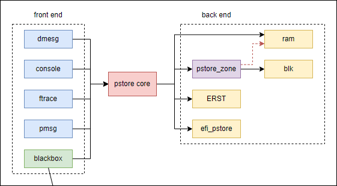
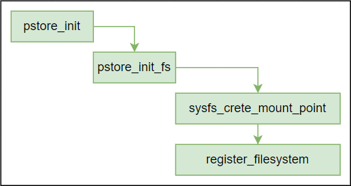
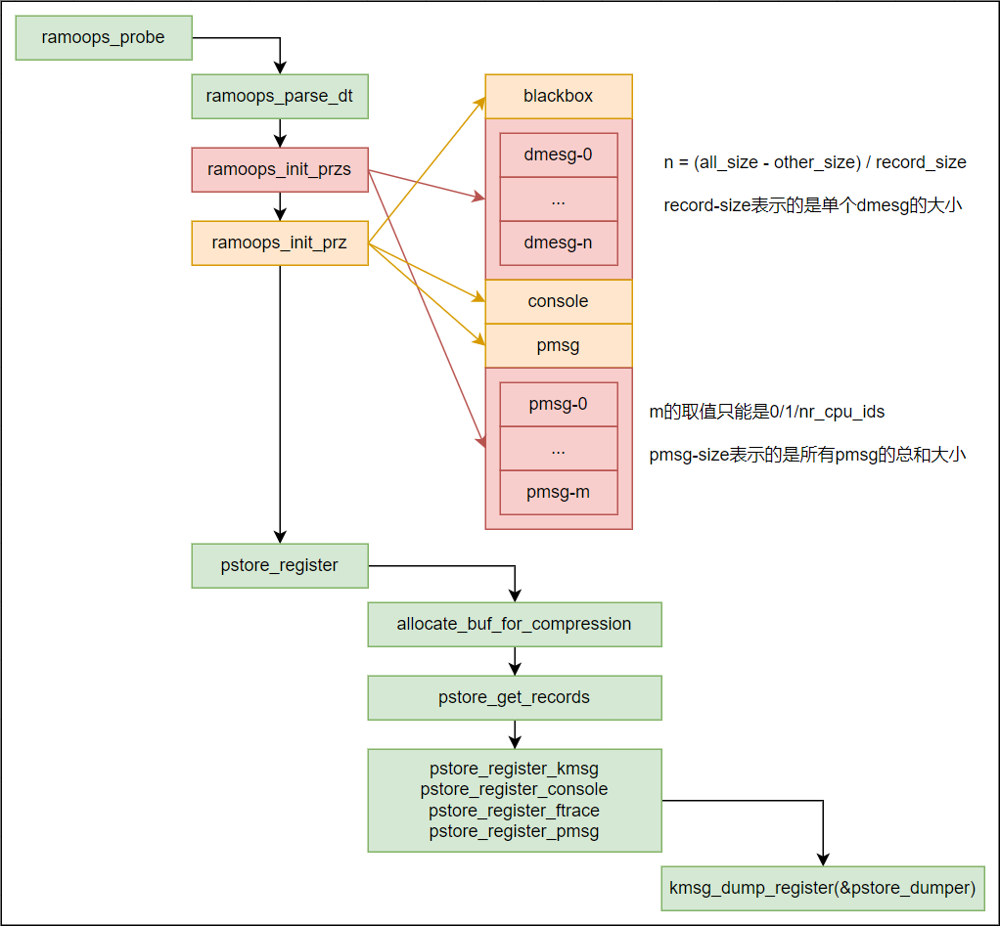
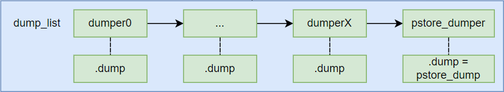
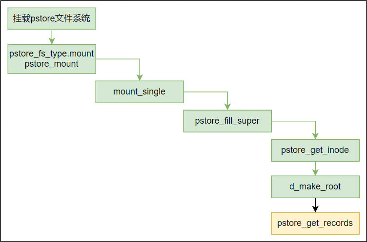
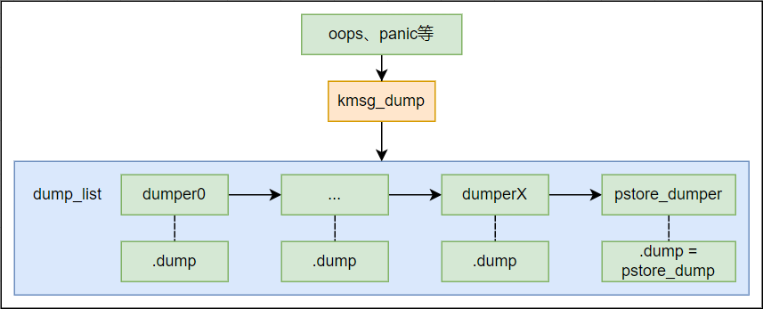
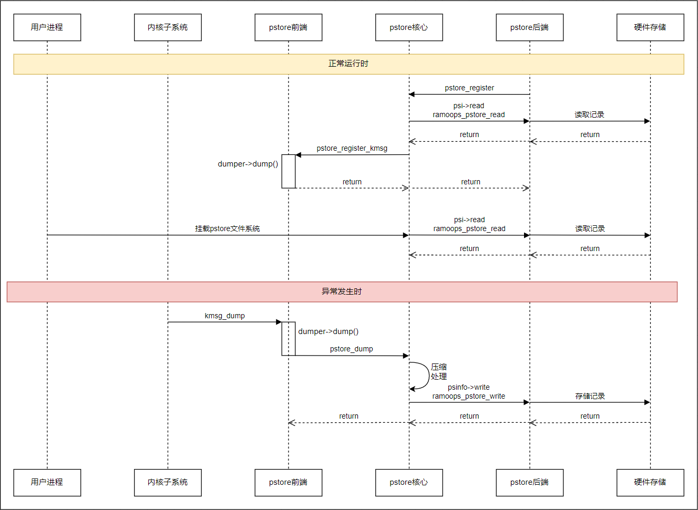
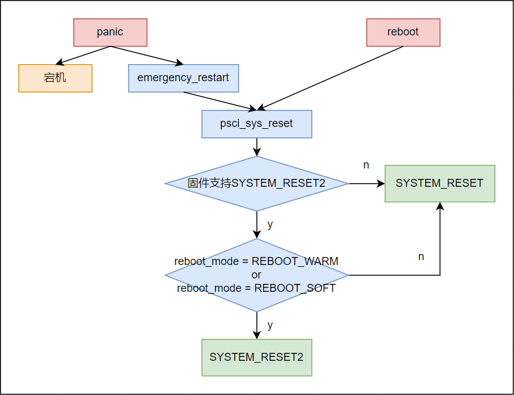

# `pstore`

> 参考链接：[linux内核调试（三）内核崩溃日志抓取pstore](https://zhuanlan.zhihu.com/p/545560128)

## 1、什么是`pstore`

​	`pstore`最初是用于系统发生`oops`或`panic`时，自动保存内核`log buffer`中的日志。不过在当前内核版本中，其已经支持了更多的功能，如保存`console`日志、`ftrace`消息和用户空间日志。同时，它还支持将这些消息保存在不同的存储设备中，如内存、块设备或`mtd`设备。

​	为例提高灵活性和可扩展性，`pstore`将以上功能分别抽象为前端和后端，其中诸如`dmesg`、`console`等为`pstore`提供数据的模块称为前端，而内存设备、块设备等用于存储数据的模块称为后端，`pstore core`则分别为它们提供相关的注册接口。

​	通过模块化的设计，实现了前端和后端的解耦，因此若某些模块需要利用`pstore`保存信息，就可以方便地向`pstore`添加新的前端。而若需要将`pstore`数据保存到新的存储设备上，也可以通过向`pstore`添加新的后端。



除此之外，`pstore`还设计了一套`pstore`文件系统，用于查询和操作上一次重启时已保存的`pstore`数据。当文件系统被挂载时，保存在`backend`中的数据将被读取到`pstore fs`中，并以文件的形式显示。

> `pstore`文件系统一般被默认挂载在`/sys/fs/pstore/`下，在这个目录下能看到`front end--back end`对应的数据文件，如`dmesg-ramoops-0`、`console-ramoops-0`等。
>
> 如果打开了`systemd-pstore.service`服务，则该服务会将`/sys/fs/pstore`下的数据文件转储到`/var/lib/systemd/pstore/`下。
>
> `dmesg`相关的内核配置是默认开启的，`console`、`ftrace`、`pmsg`则需要打开各自相关的配置才会保存对应的数据。

## 2、代码实现

### 2.1 `pstore`初始化流程

​	`pstore`初始化主要是为了初始化`pstore`文件系统，其流程如下：



1）在`/sys/fs`目录下为其创建挂载点`pstore`

2）向内核注册`pstore`文件系统

> 在创建挂载点和注册文件系统后，就可以挂载文件系统了，详细请见`2.4 pstore文件系统挂载`

### 2.2 `pstore backend`注册流程

​	`pstore core`通过结构体`struct pstore_info`来描述一个`pstore`后端，该结构体定义如下：

```c
struct pstore_info {
	struct module	*owner;
	const char	*name;

	spinlock_t	buf_lock;
	char		*buf;
	size_t		bufsize;

	struct mutex	read_mutex;

	int		flags;
	int		max_reason;
	void		*data;

	int		(*open)(struct pstore_info *psi);
	int		(*close)(struct pstore_info *psi);
	ssize_t		(*read)(struct pstore_record *record);
	int		(*write)(struct pstore_record *record);
	int		(*write_user)(struct pstore_record *record,
				      const char __user *buf);
	int		(*erase)(struct pstore_record *record);
};
```

* `name`：后端设备名字，如`ramoops`

* `buf`：用于保存实际的消息

* `flags`：用于表示消息类型，定义如下：

  * ```c
    #define PSTORE_FLAGS_DMESG	BIT(0)
    #define PSTORE_FLAGS_CONSOLE	BIT(1)
    #define PSTORE_FLAGS_FTRACE	BIT(2)
    #define PSTORE_FLAGS_PMSG	BIT(3)
    #define PSTORE_FLAGS_BLACKBOX	BIT(4)
    ```

* `max_reason`：该参数只有前端为`DMESG`时才有效，用于控制哪些消息允许被`dump`到`pstore`中。只有小于等于该值的消息才会被`dump`，其取值如下：

  * ```c
    enum kmsg_dump_reason {
    	KMSG_DUMP_UNDEF,
    	KMSG_DUMP_PANIC,
    	KMSG_DUMP_OOPS,
    	KMSG_DUMP_EMERG,
    	KMSG_DUMP_SHUTDOWN,
    	KMSG_DUMP_MAX
    };
    ```

* `data`：后端设备的私有数据


当设备树描述和驱动匹配时，`ramoops_probe`开始进行注册：



（1）解析设备树

（2）初始化`Persistent RAM Zones`

（3）注册`pstore backend`

​	A、为压缩分配输出缓冲区和`zlib`工作区。压缩算法仅支持`deflate`

​	B、将上一次重启时已保存在`pstore backend`中的信息读取出来并加入文件系统中

​	C、注册`pstore frontend`

> 查看源码时笔者发现，压缩缓冲区大小反而比原始记录大小要大，如下：
>
> ```c
> compressed_size = (psinfo->bufsize * 100) / DMESG_COMP_PERCENT;
> ```
>
> 如果压缩后的大小比原始记录还要大，那还需要压缩干什么？
>
> 解答：其实这里我们需要区分压缩缓冲区大小和压缩后数据大小是两个概念。`zlib/deflate`压缩算法在最坏的情况下输出可能比输入大（理论上存在“不可压缩”的数据，压缩后可能比原始数据大一点），即压缩后数据大小比原始记录要大，这时就不会使用压缩数据。但是即使最终决定“压缩后变大就不使用压缩数据”，压缩函数仍然需要先把数据压缩到某个缓冲区，然后才能比较压缩后大小和原始大小。如果这个缓冲区不够大，压缩函数可能直接失败，而不是返回一个“压缩后变大”的结果。

### 2.3 `pstore frontend`注册流程

​	`Pstore frontend`主要包含两个部分，何时触发`pstore`写操作，以及需要向`pstore`写入什么内容，下面以`dmesg`前端为例介绍其实现。

```c
static struct kmsg_dumper pstore_dumper = {
	.dump = pstore_dump,
};

/*
 * Register with kmsg_dump to save last part of console log on panic.
 */
static void pstore_register_kmsg(void)
{
	kmsg_dump_register(&pstore_dumper);
}
```



​	`kmsg_dump_register`函数会将`pstore_dumper`注册到`dump_list`链表中。当内核发生`oops`、`panic`或者重启等事件时，都会调用`kmsg_dump`函数，而`kmsg_dump`函数中会遍历`dump_list`链表中所有的`kmsg_dumper`，并执行其回调函数`dump`。有关日志的存储详细请看`2.5 pstore日志保存`

### 2.4 `pstore`文件系统挂载

​	在`pstore`文件系统挂载时会调用`pstore_fs_type`中的`mount`回调。`pstore_fs_type`就是`pstore`初始化时注册文件系统所用的参数，具体流程如下：



1）为文件系统分配并初始化一个`VFS inode`

2）创建文件系统的根`dentry`，并把`inode`绑定到这个`dentry`上

3）将上一次重启时已保存在`pstore backend`中的信息读取出来并加入文件系统中

> 这里你可能疑惑：`pstore`文件系统是内存里的，为什么还要像磁盘文件系统那样创建`inode`？
>
> 无论底层是内存、磁盘还是固件，只要想被`Linux`当前文件系统挂载访问，就必须提供`inode`和`dentry`这些抽象对象。

`pstore_get_records`函数的实现如下：

```c
void pstore_get_backend_records(struct pstore_info *psi,
				struct dentry *root, int quiet)
{
    ...
    if (IS_ENABLED(CONFIG_PSTORE_COMPRESS) && compress) {
		zstream.workspace = kvmalloc(zlib_inflate_workspacesize(),
					     GFP_KERNEL);
		zlib_inflateInit2(&zstream, -DEF_WBITS);
	}
    
	mutex_lock(&psi->read_mutex);
	if (psi->open && psi->open(psi))
		goto out;
    for (; stop_loop; stop_loop--) {
        ...
        pstore_record_init(record, psi);
        
        record->size = psi->read(record);
        ...
        decompress_record(record, &zstream);
		rc = pstore_mkfile(root, record);
        ...
    }
    ...
}
```

1）判断是否使用压缩算法

2）打开`pstore backend`设备

3）从`backend`设备中逐条读取`pstore record`信息

4）将数据解压缩

5）根据`record`的内容，为其在`pstore`文件系统中创建一个文件。此后，用户就可以通过文件查询相关消息了。

### 2.5 `pstore`日志保存

	当内核发生`oops`、`panic`或者重启等事件时，都会调用`kmsg_dump`函数，而`kmsg_dump`函数中会遍历`dump_list`链表中所有的`kmsg_dumper`，并执行其回调函数`dump`，即`pstore_dump`。

```c
static void pstore_dump(struct kmsg_dumper *dumper,
			enum kmsg_dump_reason reason)
{
    ...
    while (total < remaining) {
        ...
        pstore_record_init(&record, psinfo);
        record.buf = psinfo->buf;
        dst = big_oops_buf ?: psinfo->buf;
        ...
        /* Write dump contents. */
		if (!kmsg_dump_get_buffer(&iter, true, dst + header_size,
					  dst_size, &dump_size))
			break;
        if (big_oops_buf) {
			zipped_len = pstore_compress(dst, psinfo->buf,
						header_size + dump_size,
						psinfo->bufsize);

			if (zipped_len > 0) {
				record.compressed = true;
				record.size = zipped_len;
			} else {
				/*
				 * Compression failed, so the buffer is most
				 * likely filled with binary data that does not
				 * compress as well as ASCII text. Copy as much
				 * of the uncompressed data as possible into
				 * the pstore record, and discard the rest.
				 */
				record.size = psinfo->bufsize;
				memcpy(psinfo->buf, dst, psinfo->bufsize);
			}
		} else {
			record.size = header_size + dump_size;
		}
        
        ret = psinfo->write(&record);
        ...
    }
}
```

（1）初始化一个`record`结构体

（2）将`dump contents`写入`dst`

（3）将`dst`中数据压缩到`psinfo->buf`中

（4）调用后端写函数`psinfo->write()`将压缩后的数据写入到`pstore`后端

## 3、`pstore`流程图



## 4、`pstore`的使用

### 4.1 内核配置

```text
/* dmsg是默认使能的 */
CONFIG_PSTORE=y
CONFIG_PSTORE_RAM=y
CONFIG_PSTORE_PMSG=y
CONFIG_PSTORE_FTRACE=y
CONFIG_PSTORE_CONSOLE=y
```

### 4.2 `Uboot` + 设备树

#### `ramoops`

```shell
reserved-memory {
	#address-cells = <0x02>;
	#size-cells = <0x02>;
	ranges;

	ramoops@0 {
		no-map;
		compatible = "ramoops";
		reg = <l 0x0 0x8000000>;
		record-size = <0x100000>;
		console-size = <0x100000>;
		blackbox-size = <0x100000>;
		
		flags = <0x1>;
		max-reason = <0x1>;
	};
}
```

#### `blk`

早期（`Linux 5.8`以前）`blk`的描述和`ramoops`类似，这里笔者就不贴出具体描述信息。

现代`blk`的通用配置方式是通过内核配置或`GRUB`命令行中设置的：

```shell
CONFIG_PSTORE_BLK_BLKDEV=/dev/mmcblk0p7
CONFIG_PSTORE_BLK_KMSG_SIZE=64
CONFIG_PSTORE_BLK_PMSG_SIZE=64
CONFIG_PSTORE_BLK_CONSOLE_SIZE=64
CONFIG_PSTORE_BLK_FTRACE_SIZE=64

pstore_blk.blkdev=/dev/mmcblk0p7
pstore_blk.kmsg_size
```

## 5、其它

### 5.1 后端可以同时有几个？

在`Linux 6.9`版本之前，`pstore`的后端只能有一个，如果注册多个后端，则只有第一个注册的后端会生效，后续注册的后端会报错，如下：
```shell
[    0.129960] pstore: Using crash dump compression: deflate
[    0.130185] pstore: Registered ramoops as persistent store backend
[18034.328006] pstore: backend 'ramoops' already in use: ignoring 'efi_pstore'
```

在`Linux 6.9`版本之后，`pstore`的后端可以同时支持多个。这个笔者还没有具体去研究，后续有机会再进行相关内容补充。

### 5.2 后端和前端支持情况

| 前端/后端             | `dmesg(Oops)` | `dmesg(Panic)` | `pmsg` | `console` | `ftrace` | `blackbox` |
| --------------------- | ------------- | -------------- | ------ | --------- | -------- | ---------- |
| 块设备                | √             | ×              | √      | √         | √        | √          |
| `MTD`（`mtdoops`）    | √             | √              | ×      | ×         | ×        | ×          |
| `MTD`（`pstore/blk`） | √             | √              | √      | √         | √        | √          |
| `RAM`                 | √             | √              | √      | √         | √        | √          |

panic 发生后，内核已经不能像正常运行时那样“提交一个写请求，然后睡眠等待磁盘写完成”了。普通块设备 I/O 依赖的调度、睡眠、中断通知等机制，在 panic 上下文里要么已经停止，要么不能再可靠工作。普通块设备路径在 panic 里不可靠，但 pstore/blk 并不是走普通块 I/O 路径，它要求后端提供专门的 `panic_write`，所以能不能保存，取决于 flash的`/MTD/`块驱动有没有实现 panic 路径。

> **mtdpstore 当前主要适配 dmesg 这类记录**
> dmesg 在 panic 时是一次性快照，pstore 核心可以把它包装成若干条记录，后端按记录大小/页大小填充后写入，比较适合 MTD。
> 而 pmsg、console、ftrace 的写入模型不同：
>
> - pmsg：用户态持续写，长度任意；
> - console：逐行/逐字符输出，频率高，可能来自原子上下文；
> - ftrace：二进制环形缓冲，数据量大、格式特殊；
> - 它们往往是流式、异步、非固定长度写入，需要后端做缓冲、分片、页对齐填充、追加管理、崩溃一致性、恢复扫描等。

### 5.3 `pstore`和`SYSTEM_RESET2`的关系：

> `pstore`要正常工作，尤其是在使用 RAM 作为后端时，依赖于系统执行一种能保留内存内容的“温重置”（`Warm Reset`）。`RAM`中数据能否在重启后幸存，完全取决于重启的类型，而`SYSTEM_RESET2`正是实现这种精细控制的关键机制。

`SYSTEM_RESET`和`SYSTEM_RESET2`是`PSCI`（`Power State Coordination Interface`）规范中定义的系统重置调用，它们关系如下：

* `SYSTEM_RESET`：传统的冷重置调用，通常会导致内存内容丢失
* `SYSTEM_RESET2`：`PSCI v1.1`引入的增强调用，它允许定义更丰富的重置类型，其中最重要的一种就是`Architectural Warm Reset`（架构温重置）

`Linux`内核的`PSCI`会检测固件对`SYSTEM_RESET2`的支持情况，然后通过`reboot_mode`参数来控制当前重启的方式，如下所示：



如何设置`reboot_mode`？

* 对于`panic`导致的重启，有两种方式来设置`reboot_mode`：

  * 内核编译配置`CONFIG_WARM_REBOOT_ON_PANIC`：如果内核打入`kernel/panic: Use SYSTEM_RESET2 command for warm reset`补丁，则可以通过`CONFIG_WARM_REBOOT_ON_PANIC = y`来设置`painc`重启为热重启。

  * 内核命令行参数`reboot`：也可以通过内核命令行参数`reboot = panic_w`来设置`painc`重启为热重启。

* 对于`reboot`导致的重启，有一种方式来设置`reboot_mode`：

  * 内核命令行参数`reboot`：可以通过内核命令行参数`reboot = X`来设置常规重启的方式，其中`X`的取值如下：

    ```
    w:REBOOT_WARM
    c:REBOOT_CLOD
    h:REBOOT_HARD
    s:REBOOT_SOFT
    g:REBOOT_GPIO
    ```

    
