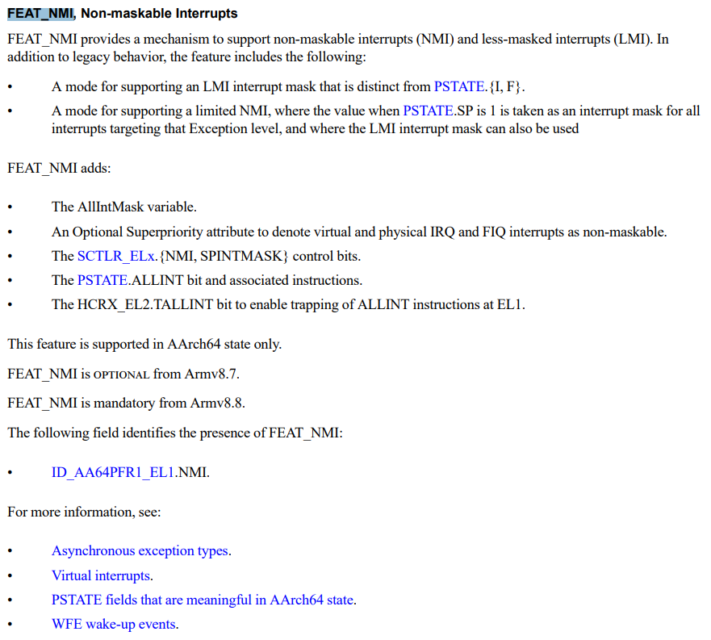
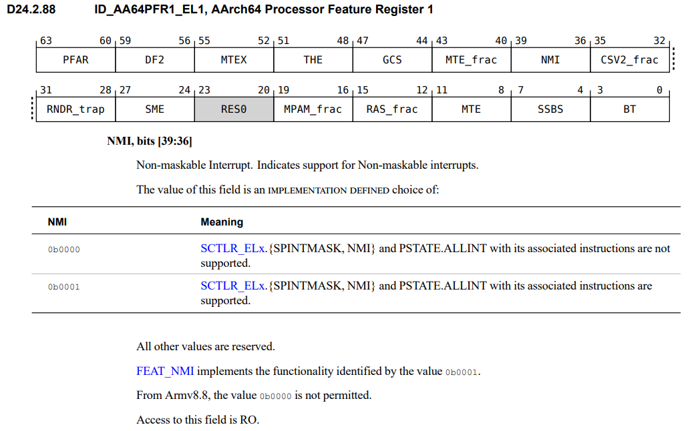

# NMI特性

## **概述**





## **检查硬件能力**

在开始功能测试前，必须先确认硬件是否具备该特性。处理器（PE）特性检查：通过读取系统寄存器`ID_AA64PFR1_EL1`的`NMI`字段来确认。

```c
#include <linux/module.h>
#include <linux/kernel.h>
#include <linux/init.h>

static int __init read_reg_init(void)
{
    unsigned long val;

    /*
     * 使用内联汇编执行 MRS 指令读取 S3_0_c0_c4_1。
     * 该寄存器在汇编语法中可直接使用 S3_0_C0_C4_1（大小写不敏感）。
     */
    asm volatile(
        "mrs %0, S3_0_C0_C4_1"
        : "=r" (val)          /* 输出：将寄存器值存入 val */
        :                     /* 没有输入 */
        :                     /* 没有被破坏的寄存器（MRS 不影响通用寄存器） */
    );

    pr_info("S3_0_c0_c4_1 register value: 0x%016lx\n", val);
    
    if (val & BIT(36))
        printk(KERN_ERR "support NMI!");

    return 0;
}

static void __exit read_reg_exit(void)
{
    pr_info("Module unloaded\n");
}

module_init(read_reg_init);
module_exit(read_reg_exit);

MODULE_LICENSE("GPL");
MODULE_DESCRIPTION("Read ARM64 system register S3_0_c0_c4_1 using inline asm");
MODULE_AUTHOR("Your Name");
```

## **测试不可屏蔽特性**

构造如下场景：在中断临界区构造死锁，即`local_irq_disable()`或`spin_lock_irqsave()`后自死锁或死循环。由于处于中断临界区时可屏蔽中断无法进入，只有`NMI`中断可以进入。因此死锁后通常会有如下日志：`watchdog: BUG: hard LOCKUP`

```c
// nmi_test.c
#include <linux/module.h>
#include <linux/kernel.h>
#include <linux/init.h>
#include <linux/delay.h>
#include <linux/kthread.h>
#include <linux/cpu.h>
#include <linux/smp.h>

static int target_cpu = 0;
module_param(target_cpu, int, 0644);
MODULE_PARM_DESC(target_cpu, "CPU to run the hardlockup simulation on");

static struct task_struct *lockup_thread;

static int lockup_fn(void *data)
{
    /* 把当前线程绑到目标 CPU */
    set_cpus_allowed_ptr(current, cpumask_of(target_cpu));

    pr_info("nmi_test: thread started on CPU %d, disabling IRQs and spinning\n",
            smp_processor_id());

    /*
     * 关中断后自旋。
     * 普通 IPI backtrace 会被屏蔽，只有 NMI 才能打断。
     */
    local_irq_disable();
    while (!kthread_should_stop()) {
        cpu_relax();
    }
    local_irq_enable();

    pr_info("nmi_test: thread exiting\n");
    return 0;
}

static int __init nmi_test_init(void)
{
    if (target_cpu >= num_online_cpus()) {
        pr_err("nmi_test: invalid target_cpu %d (online: %d)\n",
               target_cpu, num_online_cpus());
        return -EINVAL;
    }

    lockup_thread = kthread_run(lockup_fn, NULL, "nmi_test_lockup");
    if (IS_ERR(lockup_thread)) {
        pr_err("nmi_test: failed to create thread\n");
        return PTR_ERR(lockup_thread);
    }

    pr_info("nmi_test: module loaded, target CPU = %d\n", target_cpu);
    return 0;
}

static void __exit nmi_test_exit(void)
{
    if (lockup_thread) {
        kthread_stop(lockup_thread);
    }
    pr_info("nmi_test: module unloaded\n");
}

module_init(nmi_test_init);
module_exit(nmi_test_exit);

MODULE_LICENSE("GPL");
MODULE_DESCRIPTION("Simulate hardlockup to verify FEAT_NMI via SysRq l");
MODULE_AUTHOR("test");
```

`insmod nmi_test.ko`后，可以使用`echo l > /proc/sysrq-trigger`指令请求各cpu打印当前调用栈到内核日志，查看是否会出现预期结果。

## **中断嵌套**

```c
// SPDX-License-Identifier: GPL-2.0
/*
 * nmi_nesting_test.c - ARM64 FEAT_NMI interrupt nesting verification module
 *
 * Test objectives:
 *   1. An NMI can be triggered while a maskable IRQ handler is running
 *      (i.e. the NMI is not blocked by the IRQ masking).
 *   2. The PSTATE fields (I/F, ALLINT, etc.) captured in the NMI handler
 *      match the FEAT_NMI expectations.
 *
 * Usage example:
 *   insmod nmi_nesting_test.ko \
 *       gicd_base_phys=0x26800000 \
 *       gicd_size=0x10000 \
 *       test_irq_num=40 \
 *       test_nmi_num=41
 */

#include <linux/module.h>
#include <linux/kernel.h>
#include <linux/init.h>
#include <linux/interrupt.h>
#include <linux/irq.h>
#include <linux/cpumask.h>
#include <linux/delay.h>
#include <linux/completion.h>
#include <linux/io.h>
#include <linux/types.h>

#include <asm/irq.h>
#include <asm/sysreg.h>
#include <asm/ptrace.h>

/* ---------- GICD register offsets ---------- */
#define GICD_CTLR        0x0000
#define GICD_TYPER       0x0004
#define GICD_ISENABLER   0x0100
#define GICD_ICENABLER   0x0180
#define GICD_ISPENDR     0x0200
#define GICD_ICPENDR     0x0280
#define GICD_INMIR       0x0F80

/* GICD_TYPER.NMI is bit 9 */
#define GICD_TYPER_NMI   (1U << 9)

/* ---------- PSTATE bits (ARMv8-A SPSR/PSTATE layout) ---------- */
#define PSTATE_F           (1UL << 6)
#define PSTATE_I           (1UL << 7)
#define PSTATE_A           (1UL << 8)
#define PSTATE_D           (1UL << 9)

#ifndef PSTATE_ALLINT
#define PSTATE_ALLINT      (1UL << 13)
#endif

/* ---------- Module parameters ---------- */
static unsigned long gicd_base_phys = 0x26800000UL;
module_param(gicd_base_phys, ulong, 0444);
MODULE_PARM_DESC(gicd_base_phys, "GIC Distributor physical base address");

static unsigned long gicd_size = 0x10000UL;
module_param(gicd_size, ulong, 0444);
MODULE_PARM_DESC(gicd_size, "GIC Distributor register region size (bytes)");

static int test_irq_num = 40;
module_param(test_irq_num, int, 0444);
MODULE_PARM_DESC(test_irq_num, "SPI number used as the maskable IRQ");

static int test_nmi_num = 41;
module_param(test_nmi_num, int, 0444);
MODULE_PARM_DESC(test_nmi_num, "SPI number used as the NMI");

/* ---------- Global state ---------- */
static void __iomem *gicd_base;
static struct completion nmi_done;
static volatile int irq_entered;
static volatile int nmi_entered;
static u64 irq_pstate;
static u64 nmi_pstate;

/* ---------- PSTATE / DAIF readers ---------- */
static inline u64 read_current_pstate(void)
{
    u64 pstate;
    asm volatile("mrs %0, spsr_el1" : "=r"(pstate));
    return pstate;
}

static inline u64 read_daif(void)
{
    u64 daif;
    asm volatile("mrs %0, daif" : "=r"(daif));
    return daif;
}

/* ---------- GICD helpers (use the global gicd_base) ---------- */
static inline void gic_spi_enable(u32 intid)
{
    writel(1U << (intid % 32),
           gicd_base + GICD_ISENABLER + (intid / 32) * 4);
}

static inline void gic_spi_disable(u32 intid)
{
    writel(1U << (intid % 32),
           gicd_base + GICD_ICENABLER + (intid / 32) * 4);
}

static inline void gic_spi_trigger(u32 intid)
{
    writel(1U << (intid % 32),
           gicd_base + GICD_ISPENDR + (intid / 32) * 4);
}

static inline void gic_spi_set_nmi(u32 intid, bool enable)
{
    u32 off = GICD_INMIR + (intid / 32) * 4;
    u32 bit = 1U << (intid % 32);
    u32 val = readl(gicd_base + off);

    if (enable)
        val |= bit;
    else
        val &= ~bit;

    writel(val, gicd_base + off);
}

/* ---------- NMI handler ---------- */
static irqreturn_t test_nmi_handler(int irq, void *dev_id)
{
    nmi_entered = 1;
    nmi_pstate = read_current_pstate();

    pr_info("[NMI] entered, PSTATE=0x%llx, DAIF=0x%llx\n",
            nmi_pstate, read_daif());

    complete(&nmi_done);
    return IRQ_HANDLED;
}

/* ---------- Maskable IRQ handler ---------- */
static irqreturn_t test_irq_handler(int irq, void *dev_id)
{
    irq_entered = 1;
    irq_pstate = read_current_pstate();

    pr_info("[IRQ] entered, PSTATE=0x%llx, DAIF=0x%llx\n",
            irq_pstate, read_daif());

    /* Software-trigger the SPI that has been configured as an NMI */
    gic_spi_trigger(test_nmi_num);

    if (!wait_for_completion_timeout(&nmi_done, msecs_to_jiffies(1000)))
        pr_err("[IRQ] NMI did not arrive within 1s\n");

    return IRQ_HANDLED;
}

/* ---------- Module init ---------- */
static int __init nmi_nesting_test_init(void)
{
    int ret;
    u32 typer;

    pr_info("nmi_nesting_test: gicd_base_phys=0x%lx size=0x%lx irq=%d nmi=%d\n",
            gicd_base_phys, gicd_size, test_irq_num, test_nmi_num);

    init_completion(&nmi_done);
    irq_entered = 0;
    nmi_entered = 0;

    /* 1. Map the GICD region */
    gicd_base = ioremap(gicd_base_phys, gicd_size);
    if (!gicd_base) {
        pr_err("ioremap(0x%lx, 0x%lx) failed\n", gicd_base_phys, gicd_size);
        return -ENOMEM;
    }

    /* 2. Check whether the GIC supports NMI */
    typer = readl(gicd_base + GICD_TYPER);
    pr_info("GICD_TYPER=0x%08x\n", typer);
    if (!(typer & GICD_TYPER_NMI)) {
        pr_err("GIC does not support NMI (GICD_TYPER.NMI=0)\n");
        ret = -EOPNOTSUPP;
        goto err_unmap;
    }

    /* 3. Mark the NMI SPI as non-maskable: disable first, then enable */
    gic_spi_disable(test_nmi_num);
    gic_spi_set_nmi(test_nmi_num, true);
    gic_spi_enable(test_nmi_num);

    /* 4. Register the maskable IRQ */
    ret = request_irq(test_irq_num, test_irq_handler,
                      IRQF_TRIGGER_RISING, "test_irq", NULL);
    if (ret) {
        pr_err("request_irq(%d) failed: %d\n", test_irq_num, ret);
        goto err_unmap;
    }

    /* 5. Register the NMI */
    ret = request_nmi(test_nmi_num, test_nmi_handler, 0, "test_nmi", NULL);
    if (ret) {
        pr_err("request_nmi(%d) failed: %d\n", test_nmi_num, ret);
        goto err_free_irq;
    }

    /* 6. Software-trigger the maskable IRQ to start the nesting sequence */
    gic_spi_trigger(test_irq_num);

    /* 7. Wait for the result */
    msleep(2000);

    /* ---------- Result evaluation ---------- */
    if (!irq_entered) {
        pr_err("TEST FAIL: IRQ handler never executed\n");
        ret = -EIO;
        goto err_free_nmi;
    }

    if (!nmi_entered) {
        pr_err("TEST FAIL: NMI handler never executed\n");
        ret = -EIO;
        goto err_free_nmi;
    }

    pr_info("IRQ PSTATE: I=%d F=%d A=%d D=%d ALLINT=%d\n",
            !!(irq_pstate & PSTATE_I), !!(irq_pstate & PSTATE_F),
            !!(irq_pstate & PSTATE_A), !!(irq_pstate & PSTATE_D),
            !!(irq_pstate & PSTATE_ALLINT));

    pr_info("NMI PSTATE: I=%d F=%d A=%d D=%d ALLINT=%d\n",
            !!(nmi_pstate & PSTATE_I), !!(nmi_pstate & PSTATE_F),
            !!(nmi_pstate & PSTATE_A), !!(nmi_pstate & PSTATE_D),
            !!(nmi_pstate & PSTATE_ALLINT));

    if (nmi_pstate & PSTATE_ALLINT)
        pr_info("PASS: PSTATE.ALLINT set in NMI context\n");
    else
        pr_info("INFO: PSTATE.ALLINT clear in NMI context\n");

    pr_info("TEST PASS: IRQ -> NMI nesting observed\n");
    ret = 0;

err_free_nmi:
    free_nmi(test_nmi_num, NULL);
err_free_irq:
    free_irq(test_irq_num, NULL);
err_unmap:
    iounmap(gicd_base);
    gicd_base = NULL;
    return ret;
}

static void __exit nmi_nesting_test_exit(void)
{
    pr_info("nmi_nesting_test: unloading\n");
}

module_init(nmi_nesting_test_init);
module_exit(nmi_nesting_test_exit);

MODULE_LICENSE("GPL");
MODULE_DESCRIPTION("ARM64 FEAT_NMI interrupt nesting test");
MODULE_AUTHOR("Test");
```

