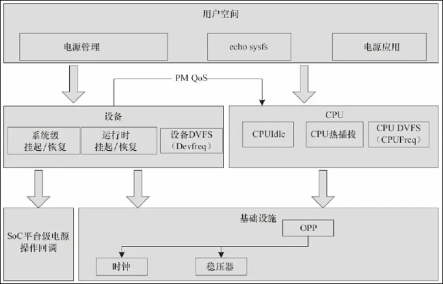

# 开篇

## 1、电源状态介绍

| 状态               | 解释                                                         | 比喻             |
| ------------------ | ------------------------------------------------------------ | ---------------- |
| power on（运行）   | 设备正常运行执行所有任务                                     | 干活中           |
| power save（节能） | 部分应用挂起或退出，关键应用还在运行。可以有多种节能模式，如哨兵模式 | 只干重要的活     |
| standby（待机）    | 计算机会关闭显示器和硬盘等设备，但保留内存和一些关键的硬件设备，以便在需要时快速唤醒恢复 | 眯一会，没睡着   |
| sleep（睡眠）      | 把所有正在运行的应用程序和数据保存到内存中，并关闭所有硬件设备，需要电源唤醒 | 睡着了           |
| hibernate（冬眠）  | 保存到硬盘，然后关机，零消耗                                 | 冬眠，睡死过去了 |
| power off（关机）  | 所有软硬件关闭                                               | 生命结束         |

## 2、`Linux`电源管理的组成

​	`Linux`内核电源管理的整体架构组成，大体可以归纳为如下几类：

	1. `CPU`在运行时根据系统负载进行动态电压和频率变换的`CPUFreq`
	1. `CPU`在系统空闲时根据空闲的情况进行低功耗模式的`CPUIdle`
	1. 多核系统下`CPU`的热插拔支持
	1. 系统和设备针对延迟的特别需求而提出申请的`PM QOS`，它会作用于`CPUIdle`的具体策略
	1. 设备驱动针对系统挂起到`RAM`/硬盘的一系列入口函数
	1. `SoC`进入挂起状态，`SDRAM`自刷新的入口
	1. 设备的运行时动态电源管理，根据使用情况状态开关设备
	1. 低层的时钟、稳压器、频率/电压表支撑，各驱动子系统都可能用到
