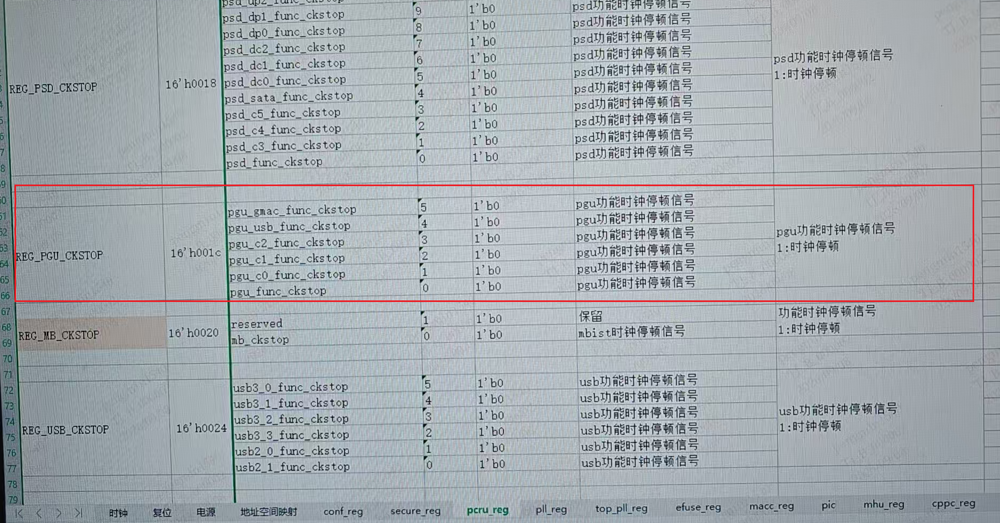
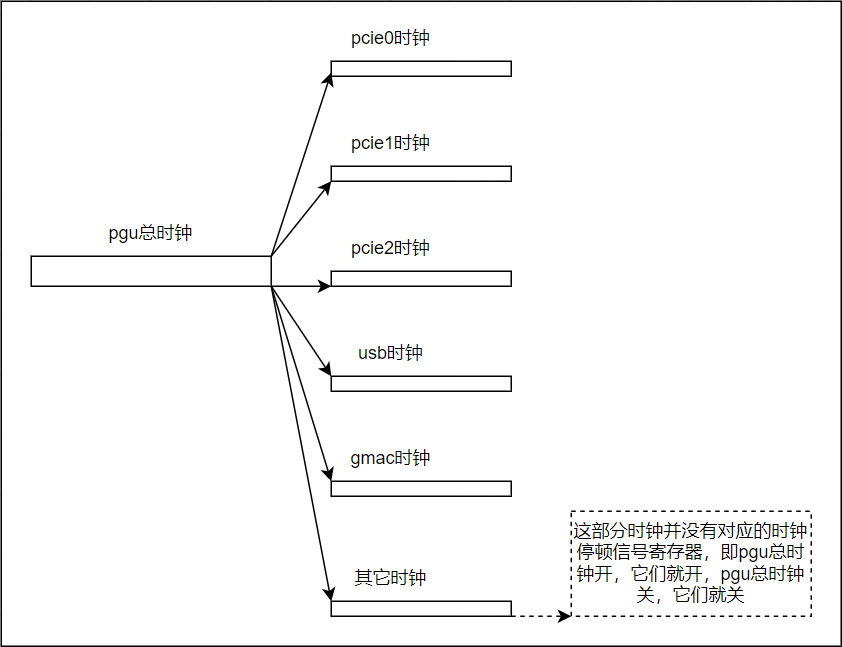
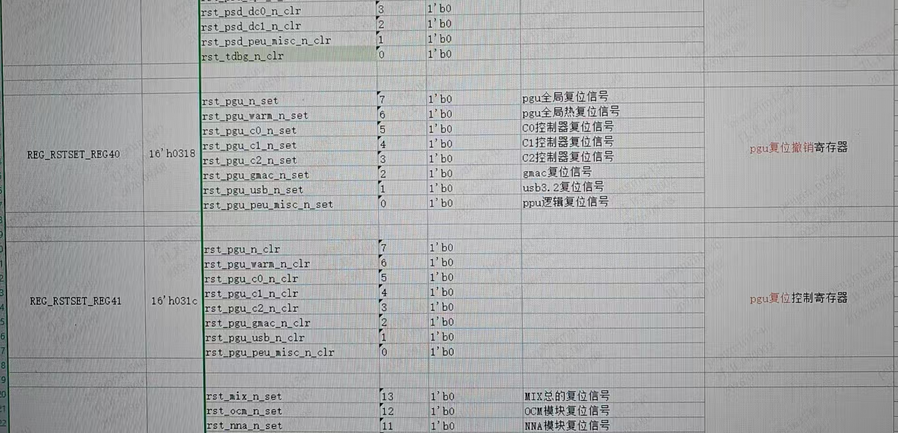

# `SE`侧各模块时钟及复位相关寄存器

> 相关文档：《Leopard-T-T02-SE-registers.xls》


打开`《Leopard-T-T02-SE-registers.xls》`表的`pcru_reg`页面，其中包含各模块的时钟停顿信号寄存器、复位控制寄存器、复位撤销寄存器，接下来主要介绍上述寄存器的使用方法和注意事项。

## 时钟停顿信号寄存器

时钟停顿信号寄存器写`1`时，对应模块的时钟关断。以`0x1c`寄存器（`pgu`功能时钟停顿寄存器）为例，如下图所示：





## 复位撤销/控制寄存器



为了方便理解这两个寄存器的作用，我们可以把复位这个操作拆成关闭和重新打开这两步操作，分别对应复位控制和复位撤销这两个寄存器。当往复位控制寄存器中写`1`时，对应模块被关闭，而当往复位撤销寄存器中写`1`时，对应模块重新打开。

>  （笔者暂时也没搞懂这里关闭/打开是关闭/打开什么东西，不过应该不是时钟，也不是电源，因为已存在时钟和电源的寄存器）

需要注意的是，这两个寄存器在逻辑上是两个寄存器，在物理上却是同一个寄存器，所以在读写该寄存器时会发现一些奇妙的现象。以`0x318`和`0x31c`寄存器为例（`pgu`复位撤销/控制寄存器）：

```
# 这时在进OS后看的两个寄存器的值，此时应该是做过复位操作，
# 即往两个寄存器分别写过ff，所以两个寄存器读出来都是ff，而
# 不是表中的默认的复位值0
D3000M-SE# md 0x40100318
40100318: 000000ff
D3000M-SE# md 0x4010031c
4010031c: 000000ff

# 如果对usb做复位操作，可以看到打印出的值为写入值的取反，reserved的bit位依旧保持为0
D3000M-SE# mw 0x4010031c 0x2
4010031c: 000000fD
# 此时usb被关闭
# 再打开usb
D3000M-SE# mw 0x40100318 0x2
40100318: 00000002
```

